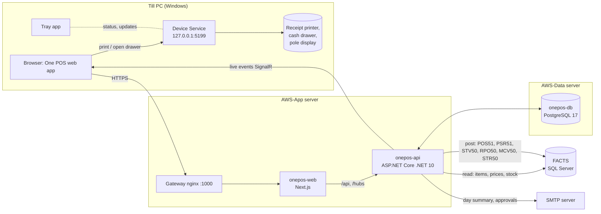
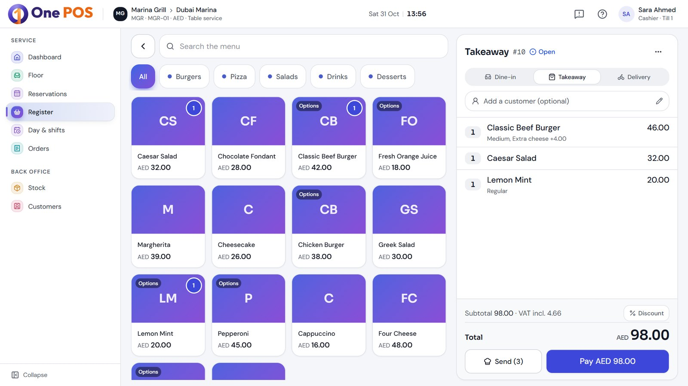
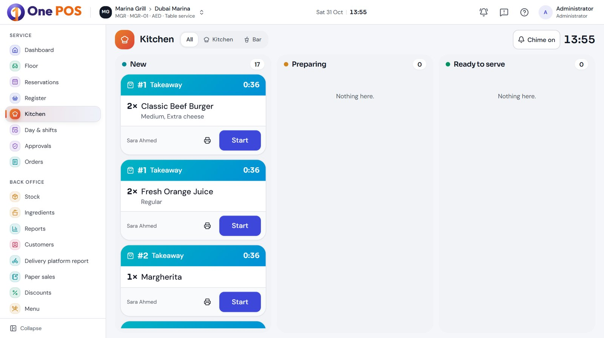
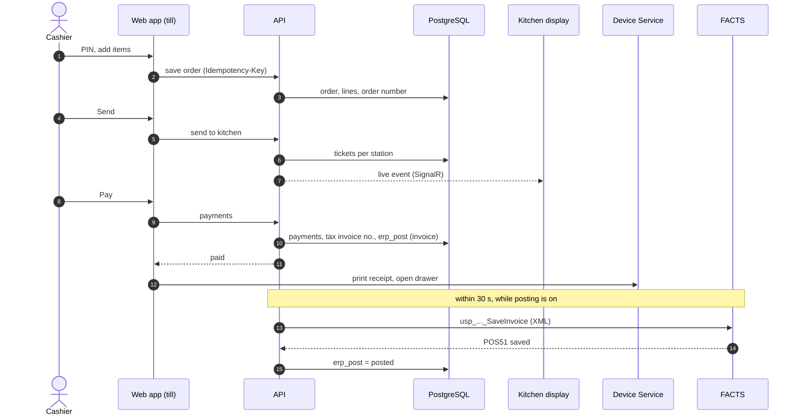
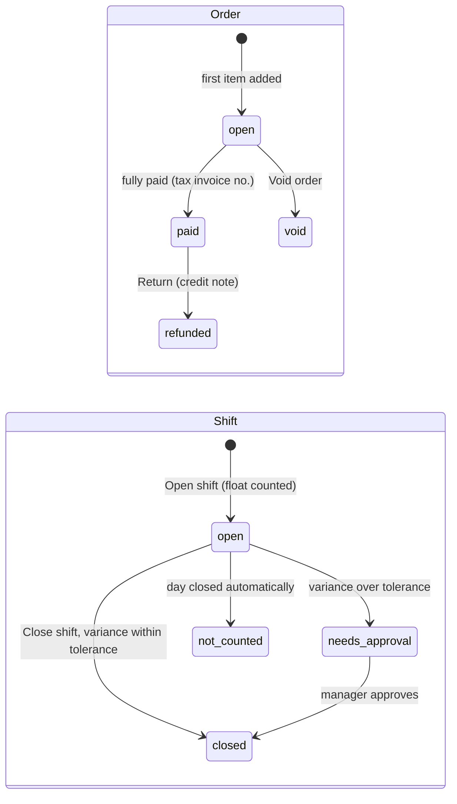
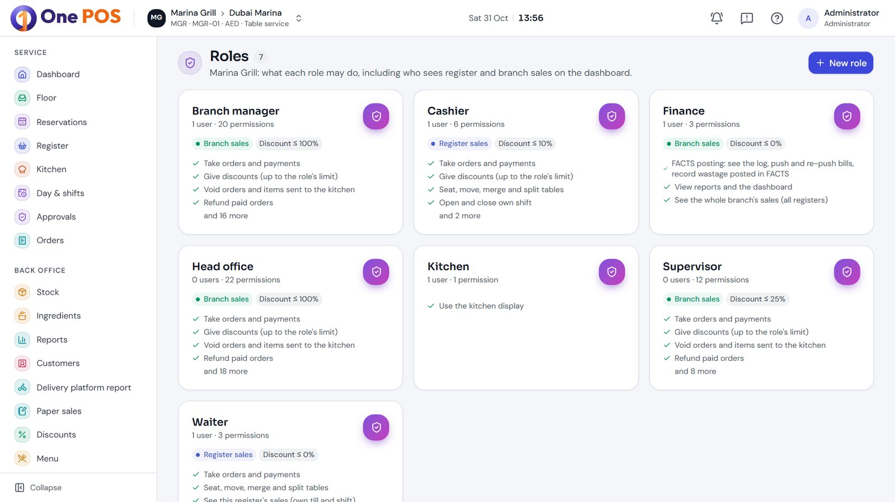

# 1. Architecture

One POS is a browser-based point of sale: a Next.js web app and an ASP.NET Core API over one PostgreSQL
database, with a small Windows service on each till for the printer and cash drawer, and an optional link to FACTS (the ERP).

## The parts

| Part | Technology | Source | Job |
| --- | --- | --- | --- |
| Web app | Next.js 16, React 19, Tailwind 4, motion | `web/` | Every screen: back office, till (`/till`), kitchen, customer display (`/display`), order-ready TV (`/pickup`), digital receipt (`/r/<token>`) |
| API | ASP.NET Core, .NET 10, Dapper, Npgsql, Microsoft.Data.SqlClient | `src/OnePos.Api/` | All business rules, numbering, FACTS sync and posting, emails, live events |
| Database | PostgreSQL 17 | `db/migrations/` | All data, one database for all companies, separated by row-level security |
| Device Service | .NET Windows service | `src/OnePos.DeviceService/` | Receipt printing (ESC/POS raster, Arabic), cash drawer, pole display, self-update |
| Tray app | .NET WinForms | `src/OnePos.DeviceTray/` | Shows the service state, test print, check for updates |
| FACTS procedures | T-SQL | `db/facts/` | One POS' own procedures in FACTS for posting stock documents |

The UI theme, components and animations are the same as AWS One (`web/src/components/ui`, `motion.tsx`, `kit.tsx`).

## API layout

| Folder | Holds |
| --- | --- |
| `Platform/` | Sign-in (`AuthEndpoints`), companies and branches, users and roles (`Permissions.cs`), audit log, idempotency, live hub, money rounding, business clock, problem reports, Device Service releases |
| `Pos/` | One file per area: orders, payments and returns, days and shifts, kitchen, tables, reservations, menu, BOMs, recipes, stock (wastage, deliveries, requests, returns, marketing), reports, customers, vouchers and loyalty, platforms, notices and emails |
| `Erp/` | `ErpConnections` (encrypted FACTS connection string), `FactsSync` (reads), `FactsPosting` (queue and sender) |
| `Data/` | `Db` (one transaction per unit of work, company context for RLS), `Migrator` |

Every endpoint lives under `/api` and needs a signed-in user, except sign-in, `/health`, the public receipt and the
customer display feed. Each endpoint checks a permission key (`scope.Require("pos.refund")`); the keys and the preset roles
are in `src/OnePos.Api/Platform/Permissions.cs`.

## How a sale flows

1. The cashier signs in at the till with a PIN. The till belongs to one register of one branch.
2. The first item added gives the order its number. Items, options, discounts and the customer are saved as the cashier works;
   only one device edits an order at a time.
3. **Send** makes kitchen tickets per station (when the branch's Kitchen switch is on); the kitchen display hears it live.
4. **Pay** records the payments. A fully paid order gets the next tax invoice number of the branch (`INV-<branch>-000001`).
5. The till asks its Device Service to print the receipt and open the drawer.
6. In the same transaction the bill is queued for FACTS (`erp_post`, kind `invoice`) when the branch has a "posts from" date.
7. The FACTS sender picks the queue up within 30 seconds (at once when woken) while posting is switched on for the company,
   and FACTS creates a POS51 with the same number. See [FACTS integration](04-facts-integration.md).
8. Paid orders feed the sales summary tables that the dashboard and reports read.

## Order and shift states

A business day is `open` or `closed`. A till takes payments only in an open shift of an open day (Manual day control) and
an empty order that is left is removed without using a number.

## Background jobs (hosted services in the API)

| Job | Class | What it does |
| --- | --- | --- |
| FACTS sync | `FactsSync.Schedule` | Prices and stock every 5 minutes, items every hour, payment methods hourly, per FACTS company |
| FACTS posting | `FactsPosting.Sender` | Sends the posting queue every 30 seconds, retries with growing waits |
| Automatic day | `Days.AutoDay` | Opens and closes business days for branches on the Automatic schedule |
| Sales summary | `SalesSummary.Builder` | Keeps the report summary tables up to date |
| Empty orders | `EmptyOrderSweep` | Removes orders started and left empty |
| Notices | `Notices.Sender`, `Notices.Listener` | Emails the day summary, alerts and approval requests each minute; pushes the header bell live (`pg_notify`) |
| Approval reminders | `ApprovalReminders` | Reminds approvers of requests still waiting |
| Idempotency cleanup | `Idempotency.Cleanup` | Drops idempotency keys older than 7 days, hourly |

## Live updates

Every till, kitchen screen and dashboard joins its branch's group on the SignalR hub `/hubs/live`. The API sends a small
event after each transaction commits (orders, tables, tickets, devices, settings); clients then re-read what they show.
Events carry ids, never data. A lost connection shows a "reconnecting" banner and recovers by itself.

## Security

- **Passwords:** stored only as salted hashes made by ASP.NET Core Identity's `PasswordHasher` (PBKDF2 with HMAC-SHA512,
  100,000 rounds; old hashes are upgraded at the next sign-in). Sign-in takes the same time for a user who doesn't exist, so
  usernames can't be guessed from the response. Passwords need 8–128 characters with letters and digits and may not contain
  the username. Five wrong passwords lock the account for 15 minutes. A password set by someone else, and the first
  administrator's, must be changed at the next sign-in: until then the API refuses everything else.
- **Till PINs:** 4–6 digits; repeated or running digits (1111, 1234) are refused. Stored as HMAC-SHA256(server secret,
  company + PIN), never as the PIN, and unique per company, so a PIN identifies exactly one person. Five wrong PINs pause PIN
  sign-in for 5 minutes.
- **Sessions:** a sign-in cookie per environment, `HttpOnly` (scripts can't read it) and `SameSite=Lax`, valid 16 hours and
  renewed while in use.
- **Data separation:** PostgreSQL row-level security on every company-owned table (65 of 76). The API connects as
  `onepos_app` (`NOSUPERUSER NOBYPASSRLS`) and sets `app.company_id` for each transaction, so even a query missing its
  `WHERE` can't return another company's rows. Migrations run as the separate owner role.
- **Permissions:** 22 permission keys grouped into roles per company, checked on the server by every endpoint (about 160
  checks), never only in the screen. Users see only the branches they are given. Limits per role: the largest discount %,
  refund and cash-out without approval. Over a limit, a manager approves by PIN on the same till or remotely; an approval
  covers one action, once, within 15 minutes, and both the request and the decision are logged.
- **Voids and drawer:** a void after items went to the kitchen needs the void permission and a reason; a paid bill can't be
  voided, only returned. Opening the drawer without a sale needs its own permission and a reason, and every one is counted in
  the day's Z report.
- **SQL:** every query is parameterised (Dapper `@parameters`); values typed by users never become part of SQL text.
- **Secrets:** the FACTS connection string and the SMTP password are encrypted with ASP.NET Data Protection and never shown
  again. Server settings and passwords live only in `/opt/aws/onepos/<env>/.env` (readable by its owner only), created with
  random passwords at installation; nothing secret is in the repository.
- **Containers:** the API and web app run as unprivileged users with memory and CPU limits; only the web app is reachable
  through the gateway (see [Servers and releases](06-servers-and-releases.md)).
- **Card data:** One POS never sees card numbers. Cards are taken on the bank's own terminal; One POS records only the method,
  the card type and the amount, which keeps it outside the scope of card-data (PCI DSS) storage rules.

## Audit trail

The audit log records who did what, when, at which branch, with the values before and after each change (about 140 places in
the code write to it): sign-ins, voids and line voids, discounts, refunds and returns, splits and merges, taking over
another till's order, paper bills, drawer openings without a sale, day and shift opening, closing, reopening and bank
deposits, item and price changes, users, roles, passwords, the FACTS connection, and every approval requested, given and
used. The API's database role may only add to the audit log and read it (`GRANT SELECT, INSERT`): it can't change or
delete an entry. Only administrators and users with the `audit.view` permission can see it.

## Money, numbers and simultaneous use

- **Exact money:** every amount is `numeric` (never floating point), and the build fails if code uses banker's rounding or
  converts money to `double` (`BannedSymbols.txt`); rounding is always half away from zero, as on the receipt and in FACTS.
  Local time comes from the branch's time zone, never from the server's clock settings.
- **Tax invoice numbers:** `INV-<branch>-000001` is given in the same transaction that records the last payment, so a
  failure leaves no gap and a number is never given twice. A company can instead run invoices and credit notes each as one
  series for all its branches (`company_number_series`: on/off, start date and time, optional prefix, starting number; plain
  200000, 200001 … or prefix + 6 digits, CN000001 …): from the start time the number comes from that one counter row, locked by the update that takes it. The
  starting number must be above every number with that prefix already used in One POS and in FACTS (POS51 / PSR51); prefix
  and start can't change once the first number is given; switched off, branches go back to their own numbers, and switched on again it continues. A paid bill can't be changed or deleted; it is corrected only by
  a credit note (`CN-<branch>-…`) that refers to it. The receipt carries the words TAX INVOICE / فاتورة ضريبية, the
  company's TRN, legal name and address in English and Arabic, the invoice number, date and time, the amount before VAT and
  the VAT.
- **One device per order:** an order being edited is locked to that device (others see who has it and can take it over,
  which is logged), and each change locks the order's row in the database (`SELECT … FOR UPDATE`), so two tills can't
  overwrite each other.
- **No double charges on bad networks:** every write carries an `Idempotency-Key`; the app retries a dropped request up to
  three times with the same key, and the API returns the first result instead of doing it again.
- **Day end:** each shift closes with a blind cash count, the variance against expected cash, and manager approval above the
  branch's tolerance; the day closes with a Z report and an email to managers listing variances, voids, refunds, drawer
  openings and discounts over limits.

## Design rules

- Table service and the kitchen are per-branch switches; optional features each have a switch, mostly off by default.
- Every page follows the branch chosen in the header; customers belong to one branch.
- Items and prices come from FACTS: an item without a FACTS price cannot be sold. One POS adds combos and options; BOMs are read from FACTS outlet BOMs (BOMO50).
- The API never writes to FACTS tables itself: it calls FACTS procedures, which run FACTS' own approval framework. One-off
  corrections (`db/facts/fixes/`) are run by hand in FACTS by the business, never by the app.
