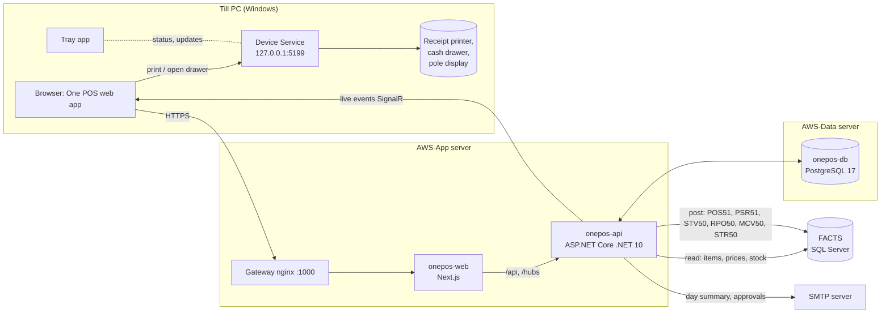
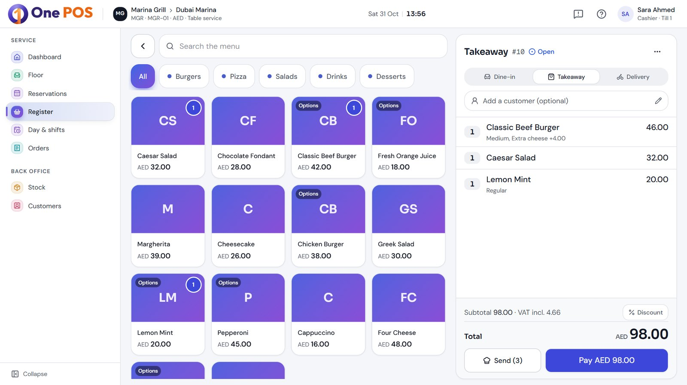
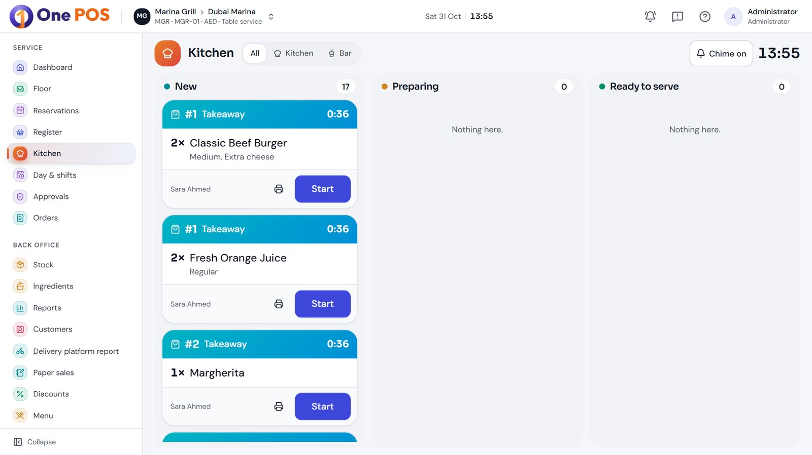
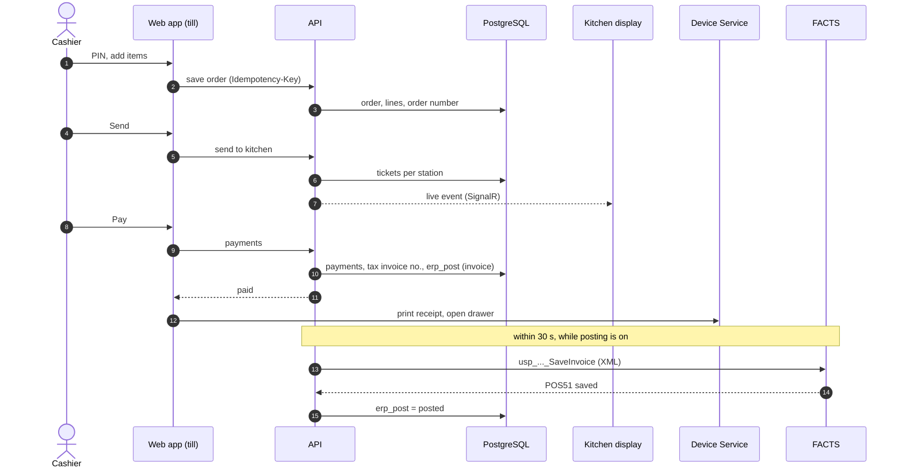
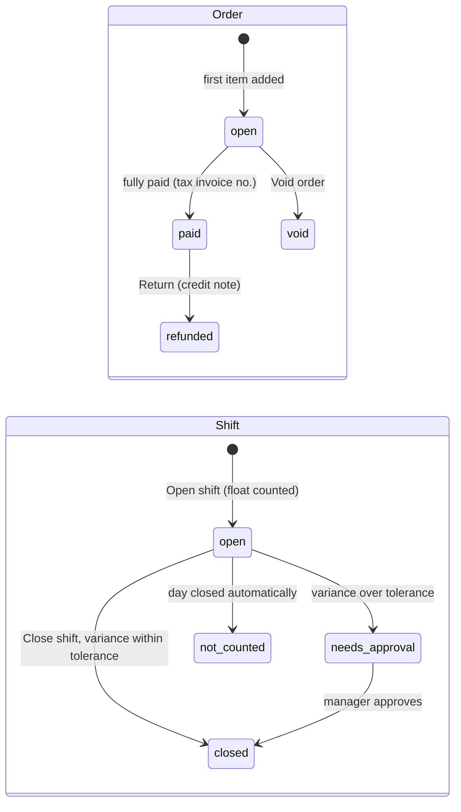
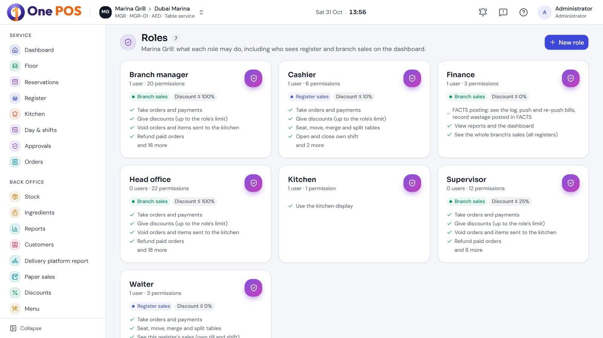

# 1. Architecture

One POS is an online-only, browser-based point of sale: a Next.js web app and an ASP.NET Core API over one PostgreSQL
database, with a small Windows service on each till for the printer and cash drawer, and an optional link to FACTS (the ERP).

## The parts

| Part | Technology | Source | Job |
| --- | --- | --- | --- |
| Web app | Next.js 16, React 19, Tailwind 4, motion | `web/` | Every screen: back office, till (`/till`), kitchen, customer display (`/display`), order-ready TV (`/pickup`), digital receipt (`/r/<token>`) |
| API | ASP.NET Core, .NET 10, Dapper, Npgsql, Microsoft.Data.SqlClient | `src/OnePos.Api/` | All business rules, numbering, FACTS sync and posting, emails, live events |
| Database | PostgreSQL 17 | `db/migrations/` | All data, one database for all companies, separated by row-level security |
| Device Service | .NET Windows service | `src/OnePos.DeviceService/` | Receipt printing (ESC/POS raster, Arabic), cash drawer, pole display, self-update |
| Tray app | .NET WinForms | `src/OnePos.DeviceTray/` | Shows the service state, test print, check for updates |
| FACTS procedures | T-SQL | `db/facts/` | One POS' own procedures in FACTS for posting stock documents |

The UI theme, components and animations are the same as AWS One (`web/src/components/ui`, `motion.tsx`, `kit.tsx`).

## API layout

| Folder | Holds |
| --- | --- |
| `Platform/` | Sign-in (`AuthEndpoints`), companies and branches, users and roles (`Permissions.cs`), audit log, idempotency, live hub, money rounding, business clock, problem reports, Device Service releases |
| `Pos/` | One file per area: orders, payments and returns, days and shifts, kitchen, tables, reservations, menu, BOMs, recipes, stock (wastage, deliveries, requests, returns, marketing), reports, customers, vouchers and loyalty, platforms, notices and emails |
| `Erp/` | `ErpConnections` (encrypted FACTS connection string), `FactsSync` (reads), `FactsPosting` (queue and sender) |
| `Data/` | `Db` (one transaction per unit of work, company context for RLS), `Migrator` |

Every endpoint lives under `/api` and needs a signed-in user, except sign-in, `/health`, the public receipt and the
customer display feed. Each endpoint checks a permission key (`scope.Require("pos.refund")`); the keys and the preset roles
are in `src/OnePos.Api/Platform/Permissions.cs`.

## How a sale flows

1. The cashier signs in at the till with a PIN. The till belongs to one register of one branch.
2. The first item added gives the order its number. Items, options, discounts and the customer are saved as the cashier works;
   only one device edits an order at a time.
3. **Send** makes kitchen tickets per station (when the branch's Kitchen switch is on); the kitchen display hears it live.
4. **Pay** records the payments. A fully paid order gets the next tax invoice number of the branch (`INV-<branch>-000001`).
5. The till asks its Device Service to print the receipt and open the drawer.
6. In the same transaction the bill is queued for FACTS (`erp_post`, kind `invoice`) when the branch has a "posts from" date.
7. The FACTS sender picks the queue up within 30 seconds (at once when woken) while posting is switched on for the company,
   and FACTS creates a POS51 with the same number. See [FACTS integration](04-facts-integration.md).
8. Paid orders feed the sales summary tables that the dashboard and reports read.

## Order and shift states

A business day is `open` or `closed`. A till takes payments only in an open shift of an open day (Manual day control) and
an empty order that is left is removed without using a number.

## Background jobs (hosted services in the API)

| Job | Class | What it does |
| --- | --- | --- |
| FACTS sync | `FactsSync.Schedule` | Prices and stock every 5 minutes, items every hour, payment methods hourly, per FACTS company |
| FACTS posting | `FactsPosting.Sender` | Sends the posting queue every 30 seconds, retries with growing waits |
| Automatic day | `Days.AutoDay` | Opens and closes business days for branches on the Automatic schedule |
| Sales summary | `SalesSummary.Builder` | Keeps the report summary tables up to date |
| Empty orders | `EmptyOrderSweep` | Removes orders started and left empty |
| Notices | `Notices.Sender`, `Notices.Listener` | Emails the day summary, alerts and approval requests each minute; pushes the header bell live (`pg_notify`) |
| Approval reminders | `ApprovalReminders` | Reminds approvers of requests still waiting |
| Idempotency cleanup | `Idempotency.Cleanup` | Drops idempotency keys older than 7 days, hourly |

## Live updates

Every till, kitchen screen and dashboard joins its branch's group on the SignalR hub `/hubs/live`. The API sends a small
event after each transaction commits (orders, tables, tickets, devices, settings); clients then re-read what they show.
Events carry ids, never data. A lost connection shows a "reconnecting" banner and recovers by itself.

## Security

- **Sign-in:** back-office password (same hasher as AWS One) or till PIN. PINs are HMAC(server secret, company + PIN), unique
  per company, with lockout after failed tries. Separate sign-in cookie per environment.
- **Data separation:** Postgres row-level security on every company-owned table; the API sets `app.company_id` per
  transaction, so a missing `WHERE` cannot leak another company's rows. The API runs as `onepos_app`, migrations as the owner.
- **Permissions:** role-based keys plus limits (largest discount %, refund and cash-out without approval). Over a limit, a
  manager approves by PIN on the same till or remotely; an approval covers one action, once, within 15 minutes.
- **Secrets:** the FACTS connection string is encrypted with ASP.NET Data Protection and never shown again; server settings
  and passwords live only in `/opt/aws/onepos/<env>/.env`.
- **Audit:** every change of settings, prices, roles, voids, refunds and approvals is written to the audit log.

- **Retries:** writes carry an `Idempotency-Key`; a retry after a dropped connection returns the first result and changes nothing.

## Decisions that shape the design

- Online only. No offline mode or branch hubs (decided 15 Oct 2026); numbers are allocated by the server.
- Table service and the kitchen are per-branch switches; optional features each have a switch, mostly off by default.
- Every page follows the branch chosen in the header; customers belong to one branch.
- Items and prices come from FACTS: an item without a FACTS price cannot be sold. One POS adds combos and options; BOMs are read from FACTS outlet BOMs (BOMO50).
- The API never writes to FACTS tables itself: it calls FACTS procedures, which run FACTS' own approval framework. One-off
  corrections (`db/facts/fixes/`) are run by hand in FACTS by the business, never by the app.
