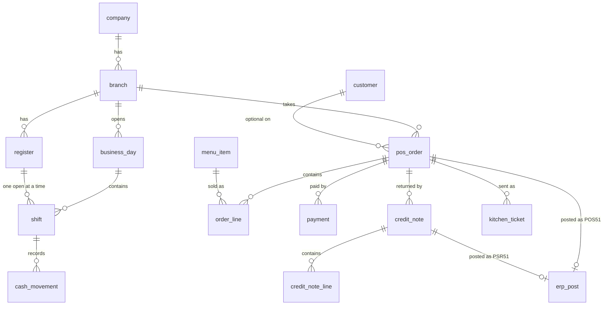

# 3. Database

One PostgreSQL 17 database per environment holds every company. Companies are separated by row-level security (RLS),
not by separate databases.

The live database runs in the container `onepos-live-db` on AWS-Data (172.30.0.20:5444).

## Roles and row-level security

- `onepos_owner` owns the schema and runs the migrations.
- `onepos_app` is what the API connects as: `NOSUPERUSER NOBYPASSRLS`.
- Every company-owned table has a `company_id` and the policy
  `company_isolation … USING (company_id = (SELECT app_company_id()))`.
- The API sets `app.company_id` at the start of each transaction (`Db.Company`). Work with no company (sign-in, the
  company list) uses `Db.Platform` and only touches platform tables.

## Main tables by area

| Area | Tables |
| --- | --- |
| Platform | `company`, `branch`, `currency`, `app_user`, `role`, `user_company`, `user_branch`, `audit_log`, `number_series`, `idempotency_key`, `feedback*` |
| Menu | `menu_category`, `menu_item` (a combo: one branch each), `item_unit`, `modifier_group` (one branch each), `modifier_option`, `menu_item_modifier`, `branch_item`, `item_price_history`, `platform_item_price`, `discount` |
| Orders | `register`, `pos_order`, `order_line`, `payment`, `credit_note`, `credit_note_line`, `receipt_link`, `no_sale`, `approval`, `approval_code` |
| Tables and kitchen | `floor`, `dining_table`, `order_table`, `reservation`, `reservation_table`, `kitchen_station`, `kitchen_ticket`, `kitchen_ticket_line` |
| Day and cash | `business_day`, `shift`, `cash_movement`, `bank_deposit` `cash_bank_adjustment` (Cash to bank: a branch owes its cash sales less cash refunds, plus amounts added with a remark (by hand, or a cash in "Cash to deposit to bank", linked by `cash_movement_id`), less its deposits, from `branch.cash_bank_from`; worked out when asked) |
| Customers and rewards | `customer` (one branch each), `voucher`, `voucher_move`, `loyalty_move` |
| Stock | `wastage` (also marketing give-aways), `delivery_check`, `stock_return`, `request_store`, `stock_request`, `stock_request_line`, `ingredient`, `recipe_line`, `branch_ingredient`, `ingredient_move`, `bom`, `bom_version`, `bom_line`, `material_unit` |
| Delivery platforms | `delivery_platform`, `platform_payout` (one branch each) |
| FACTS | `company_erp` (encrypted connection), `erp_sync` (sync log), `erp_payment_mode`, `erp_post` (posting queue and log) |
| Reports and notices | `sales_day_item`, `sales_day_built`, `notice`, `notice_read`, `approval_reminder`, `device_status`, `display_image` |

Option groups (`modifier_group.branch_id`) and combos (`menu_item.branch_id`, set only on combos) belong to the branch
they were made at: only that branch loads, sells and changes them, and a group name is unique per branch. Items from FACTS
stay shared; a group attached to one (`menu_item_modifier`) is asked for it only at the group's branch.

### Core sales tables

## Normalisation

The schema is in **third normal form (3NF)**. Every fact is kept in one place, and the few copies listed below are
kept on purpose. The full list of tables and columns is the [Data dictionary](reference/data-dictionary.md).

| Form | What it means here | How the schema meets it |
| --- | --- | --- |
| 1NF: one value per field | No lists packed into a column; each row has a key | Every table has a primary key; lines, payments, tables of an order, users of a branch are rows in their own tables (`order_line`, `payment`, `order_table`, `user_branch`), not lists in the parent |
| 2NF: no part-key facts | In a table with a key of several columns, every other column depends on the whole key | Composite keys are used only for link and per-branch tables, e.g. `branch_item (branch_id, item_id)` holds only what is true of *that item at that branch* (price, stock, on/off), while the item's name lives once in `menu_item` |
| 3NF: no facts about other facts | A column depends on the key only, not on another non-key column | A branch's name, a user's name, an item's category are looked up through their id, never copied into each order or line (apart from the snapshots below) |

### Keys

- **Surrogate keys.** Nearly every table's primary key is `id uuid DEFAULT gen_random_uuid()`. Business numbers (invoice
  number, FACTS item code, branch code) are kept as **unique** columns, not keys, so they can be corrected without
  rewriting every reference.
- **Composite keys** (15 tables) are used where a row is exactly "one A with one B": `user_company`, `user_branch`,
  `branch_item`, `branch_ingredient`, `menu_item_modifier`, `platform_item_price (platform_id, location, item_id)`, `order_table`, `reservation_table`,
  `notice_read`, `number_series (branch_id, series)`, `erp_payment_mode (branch_id, code)`,
  `material_unit (company_id, item_code, unit)`, `item_unit (item_id, unit)`, `approval_reminder`, `sales_day_built`.
- **Foreign keys** (237) tie every reference to its parent, so a row can't point at something that isn't there.
- **Natural rules as unique keys**, often partial, e.g. one invoice number per company
  `UNIQUE (company_id, invoice_no) WHERE invoice_no IS NOT NULL`, one order number per branch and day, and one FACTS
  posting per bill `UNIQUE (order_id) WHERE kind = 'invoice'` on `erp_post`.

### Copies kept on purpose (controlled denormalisation)

These break strict 3NF deliberately. Each is written once and never updated from its source.

| Copy | Where | Why |
| --- | --- | --- |
| `company_id` on every company-owned table, including child rows such as `order_line` | 64 tables | Row-level security filters each table on its own `company_id` without a join. Child rows also carry it so a policy never depends on a parent lookup |
| The sale as it was: item `name`/`name_ar`, `unit_price`, `vat`, `line_total`, discount name/type/value | `order_line`, `credit_note_line` | A tax invoice must reprint exactly as issued, even after the menu item is renamed or repriced |
| The bill's rates and totals: `vat_rate`, `prices_include_vat`, `service_pct`, `subtotal`, `discount_total`, `vat`, `total`, `paid`, `refunded` | `pos_order` | Same reason, and the totals are read on every screen and report; the API recalculates them (`Orders.RecalcAsync`) in the same transaction as every change to the lines |
| `branch_id`, `business_date` on payments, cash movements, postings | `payment`, `cash_movement`, `erp_post`, … | Day-end (X/Z) and reports sum a branch's day without joining back through the order |
| Snapshots in `jsonb`: the chosen options of a line (`order_line.modifiers`), a closed day's Z report (`business_day.z_report`), a shift's counts (`shift.opening_counts`, `closing_counts`, `z_report`) | 14 `jsonb` columns | A frozen record of what was printed or counted; nothing queries inside it to change it |
| FACTS values: `branch_item.erp_stock`, `facts_price`, FACTS codes on items | Menu and stock tables | Read from FACTS by the sync; FACTS stays the master and wins (see [FACTS integration](04-facts-integration.md)) |
| Report summaries | `sales_day_item`, `sales_day_built` | Items sold per branch and day, summed once the day is over so reports over months stay fast. A day is summed again when one of its bills changes and forgotten when the day is reopened; today is read from the bills (`Pos/SalesSummary.cs`) |

Settings that are read whole and never searched are also `jsonb` (`branch.receipt_settings`, `company.smtp_settings` and
`alert_settings`, the `limits` of `role` and `user_company`). The audit log keeps the changed values in `audit_log.data`.

## Field types and lengths

Every column's exact type, length, default and allowed values are in the [Data dictionary](reference/data-dictionary.md),
generated from the migrations. The rules the schema follows:

| Kind of value | Type | Length / size | Notes |
| --- | --- | --- | --- |
| Ids | `uuid` | 16 bytes (36 characters as text) | Made by the database, `gen_random_uuid()` |
| Money: prices, totals, VAT, payments | `numeric(14,2)` | 2 decimals, up to 999 billion | Exact decimal, never `float`; rounding is done by the API to 2 places, as on the receipt and in FACTS |
| Percentages: VAT rate, discount %, service %, platform commission | `numeric(5,2)` | up to 999.99 | Discount % has `CHECK (0–100)` |
| Quantities sold, returned, sent to the kitchen | `numeric(12,3)` | 3 decimals | Items sold by weight (e.g. 0.250 kg) |
| Stock on hand, par levels, stock moves | `numeric(14,3)` | 3 decimals | |
| Unit costs and FACTS prices | `numeric(14,4)` | 4 decimals | Cost × quantity is rounded only at the total |
| Recipe and BOM quantities, unit conversions | `numeric(12,4)`, `numeric(18,6)` | 4 or 6 decimals | Small fractions of a pack (e.g. 0.000250 of a 1 kg bag) |
| Loyalty points per unit and point value | `numeric(10,4)` | 4 decimals | |
| Counts, order numbers, versions | `integer` | 4 bytes (to 2,147,483,647) | `bigint` (8 bytes) for the invoice sequences `number_series.next_no`, audit and feedback ids, and file sizes |
| Dates and times | `timestamptz` | 8 bytes | Stored as an instant (UTC), shown in the branch's `time_zone` (default Asia/Dubai) |
| Business day | `date` | 4 bytes | The trading day, which can differ from the calendar date after midnight |
| Yes/no | `boolean` | 1 byte | `NOT NULL` with a default, apart from a few results not known until a test or sync has run |
| Codes and states (`status`, `kind`, `order_type`, payment `method`) | `text` + `CHECK (… one of …)` | the allowed words | Used instead of PostgreSQL enums, so a new value is one `ALTER … CHECK` in a migration |
| Names, notes, addresses, references | `text` | no limit in the database | See below |
| Settings, snapshots | `jsonb` | variable | See the copies above |
| The FACTS connection | `text`, encrypted | variable | `company_erp.secret`, encrypted by the API with ASP.NET Data Protection; never sent back to a screen |

**Why `text` and not `varchar(n)`.** In PostgreSQL `text` and `varchar(n)` are stored the same way and are equally fast.
A fixed length only adds a migration every time a limit changes. So text columns have no length in the schema, and limits
are set where they come from:

- **FACTS limits** are applied when a document is built for FACTS: document numbers are at most **20 characters**
  (long branch codes drop `INV-`), and the cashier name sent as `CreatedBy` is cut to 20.
- **Screen limits** where a value goes on to FACTS or a fixed place: FACTS codes and usernames (item master, division,
  price type, location, account) at 20 characters, a reason at 500, a stock-request note at 150, feedback at 200 / 8,000.
  Other names and notes are not capped.
- **CHECKs on length** where a value comes from outside (feedback page title ≤ 300, page path ≤ 2,000, browser ≤ 1,000,
  steps ≤ 8,000). These show in the dictionary's Length column.

When adding a column, follow the same types: money `numeric(14,2)`, quantities `numeric(12,3)`, `timestamptz` for times,
`text` + a CHECK for a set of values, and a foreign key for every reference.

## Indexes and speed

The database has **195 indexes** on 76 tables: 118 unique (they also enforce a business rule) and 45 partial. Every index
is listed under its table in the [Data dictionary](reference/data-dictionary.md). The everyday queries are timed in
[Query speed](reference/query-speed.md).

### How the indexes are designed

| Practice | Where it is used |
| --- | --- |
| **Index the way the app searches.** Composite indexes lead with the column the query always filters on (almost always the branch), then the date or number | `pos_order (branch_id, business_date, status)`, `payment (branch_id, business_date)`, `kitchen_ticket (branch_id, status, created_at)`, `audit_log (company_id, at DESC)` |
| **Covering indexes** (`INCLUDE`): the report reads everything it needs from the index and never touches the table | `pos_order_report (branch_id, business_date) INCLUDE (status, order_type, total, vat, discount_total, …)` for the sales summary; `payment_report … INCLUDE (kind, method, amount, taken_by)` for the day end X/Z |
| **Partial indexes** (`WHERE`): only the rows a screen looks for are indexed, so the index stays small however much history builds up | FACTS queue `erp_post (next_try_at) WHERE status = 'pending'`; open shift per till `shift (register_id) WHERE status = 'open'`; waiting approvals; uncollected takeaway and delivery orders; links that are usually empty, e.g. `pos_order (customer_id) WHERE customer_id IS NOT NULL` |
| **Unique indexes enforce rules** as well as find rows | One invoice number per company, one order number per branch and day, one FACTS posting per bill and per return, one customer per phone number at a branch |
| **Expression indexes** for case-insensitive search | `customer (branch_id, lower(name))`, `ingredient (company_id, lower(name))`, `delivery_platform (company_id, lower(name))` |
| **Descending indexes** for "newest first" lists | `audit_log`, `notice`, `item_price_history`, `erp_sync`, `feedback` |
| **Report summaries instead of scanning years of lines** | Item sales over months read `sales_day_item` (one row per branch, day and item), not every bill line (see the copies kept on purpose above) |
| **Row-level security without extra joins** | Every company-owned table carries its own `company_id`, so the security filter never needs to join another table |

### Foreign keys and their indexes

PostgreSQL indexes a primary key automatically, but not the column that points at it. An index behind a foreign key
matters in two cases: when the app finds the child rows from the parent (a bill's lines), and when it **deletes a
parent**, because PostgreSQL then checks every table that points at it.

- **103 of the 242 foreign keys** start an index. These cover every parent the app looks up from or deletes: bills, lines,
  payments, returns, shifts, days, customers, vouchers, option groups, floors and tables.
- **The other 139 are left without an index on purpose.** Each extra index slows every insert a little, and these give
  nothing back:
  - **50 `company_id`**: companies are never deleted, and queries always filter on a narrower column first.
  - **50 "who did it"** columns pointing at users (`opened_by`, `taken_by`, `decided_by`, …): users are switched off,
    never deleted, and no screen searches by them.
  - **39 links to rows the app never deletes** (it switches them off instead) and never searches from: branch, till,
    menu item, ingredient, delivery platform, role, currency, voucher, approval, and the FACTS posting of a wastage or
    stock document. Removing a till by hand (`db/maintenance/remove_tills.sql`) is the only delete, and it is rare.

### Migration 0092: the gaps found by measuring

Timing the queries on a year of data found two places where a missing index made a cashier wait. Migration
`0092_fk_indexes.sql` adds them, together with the indexes behind option groups and floors, which the app also deletes:

| What the cashier does | Was | Now | Why |
| --- | --- | --- | --- |
| Add an item at a branch that blocks short stock (counts what was sold since the last FACTS stock read) | 164 ms | **4.5 ms** | `order_line (item_id, order_id)`: without it every bill line ever rung was read |
| Open a bill and leave it empty, removed later (every table pointing at the bill is checked) | 48.6 ms | **3.2 ms** | `erp_post (order_id)`: the posting queue only had indexes for invoice and refund rows, so the whole queue was read |

None of the other queries changed (all within the normal run-to-run spread).

### How fast it is

Measured on a database built from the migrations and filled with **a year of sales for 5 branches** (547,500 bills, 1.9
million bill lines, 536,550 payments and FACTS postings), well above what the live branches ring up today. Each query runs
as the API runs it, with row-level security on. Full table: [Query speed](reference/query-speed.md).

| Kind of work | Time |
| --- | --- |
| Everything at the till: bills of the day, open a bill, find an invoice, add an item, customer by phone, returns | **0.4 – 4.5 ms** |
| Day end X/Z, close a shift, FACTS queue | **0.5 – 1 ms** |
| A branch's sales for a month | **3 ms** |
| All branches for a whole year (sales summary, item sales) | **50 – 90 ms** |

Every till and day-end query uses an index. Only the whole-year reports read a whole table, and that's right for them:
when a query needs most of the rows, reading the table straight through is faster than going through an index. The till
and day-end queries take time in proportion to what they return, not to how much history is stored, so a day's bills
take the same time after five years as after one.

To run the timing again, for example after a migration: `node tools/docs/db-benchmark.mjs` (needs Docker; about 5
minutes; `BRANCHES`, `DAYS` and `BILLS` set the size).

## Numbers

- Order numbers are given when the first item is added (an empty order uses none).
- Tax invoices: `INV-<branch code>-000001`, one sequence per branch, given when the order is fully paid. Credit notes:
  `CN-<branch code>-000001`. The same number is used in FACTS, which allows at most 20 characters (long branch codes drop
  `INV-`). Sequences live in `number_series`.

## The posting queue: `erp_post`

One row per document to send to FACTS.

| Column | Meaning |
| --- | --- |
| `kind` | `invoice`, `refund`, `wastage`, `repacking`, `return`, `marketing`, `request` |
| `status` | `pending`, `waiting` (e.g. a refund until its procedure is set), `posted`, `failed`, `skipped` (left out by a user) |
| `xml` | The exact body sent to the FACTS procedure; re-sending the same number makes FACTS revise its document |
| `attempts`, `next_try_at`, `last_error` | Retry state; waits grow after each failure |
| `facts_user` | The FACTS user the document is posted as (approver's user for stock documents) |
| `order_id`, `credit_note_id`, `branch_id` | What the row belongs to |

## Backups

Nightly dumps plus files archives on AWS-App (kept 14 days), copied to AWS-Data; live also has pgBackRest
point-in-time recovery (2 weekly full, nightly differentials, every WAL). Every live deploy takes a dump first. See
[Servers and releases](06-servers-and-releases.md).

## Hand-run scripts

`db/maintenance/clear_transactions.sql` (removes all sales, days and stock movements of a company, keeps setup) and
`remove_tills.sql`. Take a backup first and run them only with the business owner's go-ahead.
