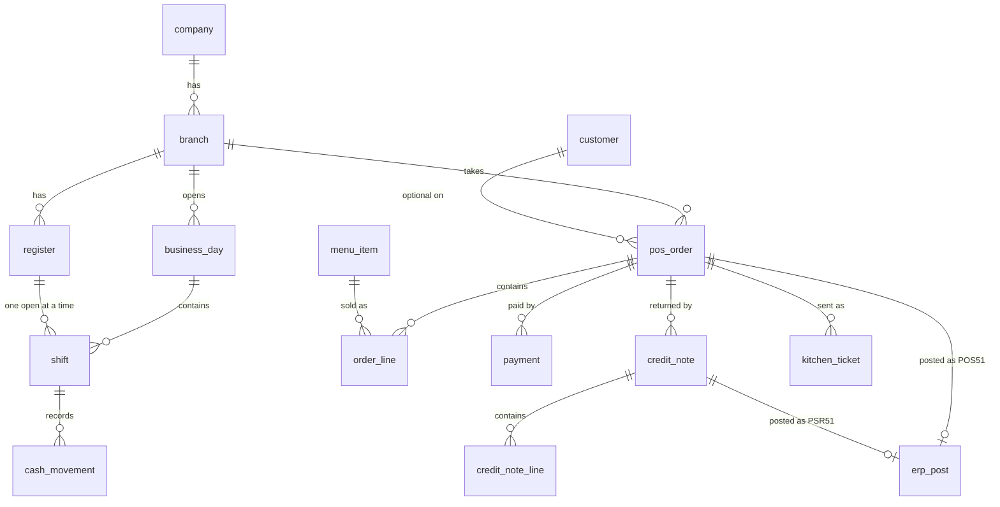

# 3. Database

One PostgreSQL 17 database per environment holds every company. Companies are separated by row-level security (RLS),
not by separate databases.

The live database runs in the container `onepos-live-db` on AWS-Data (172.30.0.20:5444).

## Roles and row-level security

- `onepos_owner` owns the schema and runs the migrations.
- `onepos_app` is what the API connects as: `NOSUPERUSER NOBYPASSRLS`.
- Every company-owned table has a `company_id` and the policy
  `company_isolation … USING (company_id = (SELECT app_company_id()))`.
- The API sets `app.company_id` at the start of each transaction (`Db.Company`). Work with no company (sign-in, the
  company list) uses `Db.Platform` and only touches platform tables.

## Main tables by area

| Area | Tables |
| --- | --- |
| Platform | `company`, `branch`, `app_user`, `role`, `user_company`, `user_branch`, `audit_log`, `number_series`, `idempotency_key`, `feedback*` |
| Menu | `menu_category`, `menu_item`, `modifier_group`, `modifier_option`, `menu_item_modifier`, `branch_item`, `item_price_history`, `platform_item_price`, `discount` |
| Orders | `register`, `pos_order`, `order_line`, `payment`, `credit_note`, `credit_note_line`, `receipt_link`, `no_sale`, `approval`, `approval_code` |
| Tables and kitchen | `floor`, `dining_table`, `order_table`, `reservation`, `reservation_table`, `kitchen_station`, `kitchen_ticket`, `kitchen_ticket_line` |
| Day and cash | `business_day`, `shift`, `cash_movement`, `bank_deposit` |
| Customers and rewards | `customer` (one branch each), `voucher`, `voucher_move`, `loyalty_move` |
| Stock | `wastage` (also marketing give-aways), `delivery_check`, `stock_return`, `request_store`, `stock_request`, `stock_request_line`, `ingredient`, `recipe_line`, `branch_ingredient`, `ingredient_move`, `bom`, `bom_version`, `bom_line`, `material_unit` |
| Delivery platforms | `delivery_platform`, `platform_payout` (one branch each) |
| FACTS | `company_erp` (encrypted connection), `erp_sync` (sync log), `erp_payment_mode`, `erp_post` (posting queue and log) |
| Reports and notices | `sales_day_item`, `sales_day_built`, `notice`, `notice_read`, `approval_reminder`, `device_status`, `display_image` |

### Core sales tables

## Numbers

- Order numbers are given when the first item is added (an empty order uses none).
- Tax invoices: `INV-<branch code>-000001`, one sequence per branch, given when the order is fully paid. Credit notes:
  `CN-<branch code>-000001`. The same number is used in FACTS, which allows at most 20 characters (long branch codes drop
  `INV-`). Sequences live in `number_series`.

## The posting queue: `erp_post`

One row per document to send to FACTS.

| Column | Meaning |
| --- | --- |
| `kind` | `invoice`, `refund`, `wastage`, `repacking`, `return`, `marketing`, `request` |
| `status` | `pending`, `waiting` (e.g. a refund until its procedure is set), `posted`, `failed`, `skipped` (left out by a user) |
| `xml` | The exact body sent to the FACTS procedure; re-sending the same number makes FACTS revise its document |
| `attempts`, `next_try_at`, `last_error` | Retry state; waits grow after each failure |
| `facts_user` | The FACTS user the document is posted as (approver's user for stock documents) |
| `order_id`, `credit_note_id`, `branch_id` | What the row belongs to |

## Backups

Nightly dumps plus files archives on AWS-App (kept 14 days), copied to AWS-Data; live also has pgBackRest
point-in-time recovery (2 weekly full, nightly differentials, every WAL). Every live deploy takes a dump first. See
[Servers and releases](06-servers-and-releases.md).

## Hand-run scripts

`db/maintenance/clear_transactions.sql` (removes all sales, days and stock movements of a company, keeps setup) and
`remove_tills.sql`. Take a backup first and run them only with the business owner's go-ahead.
