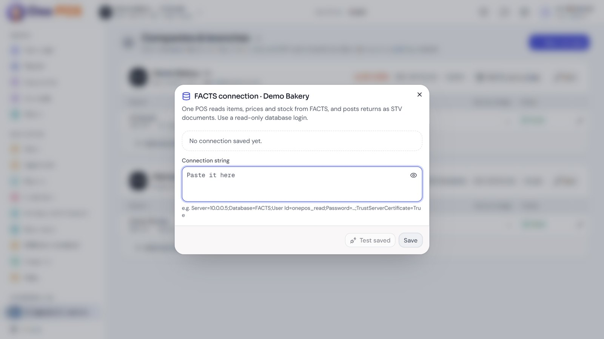
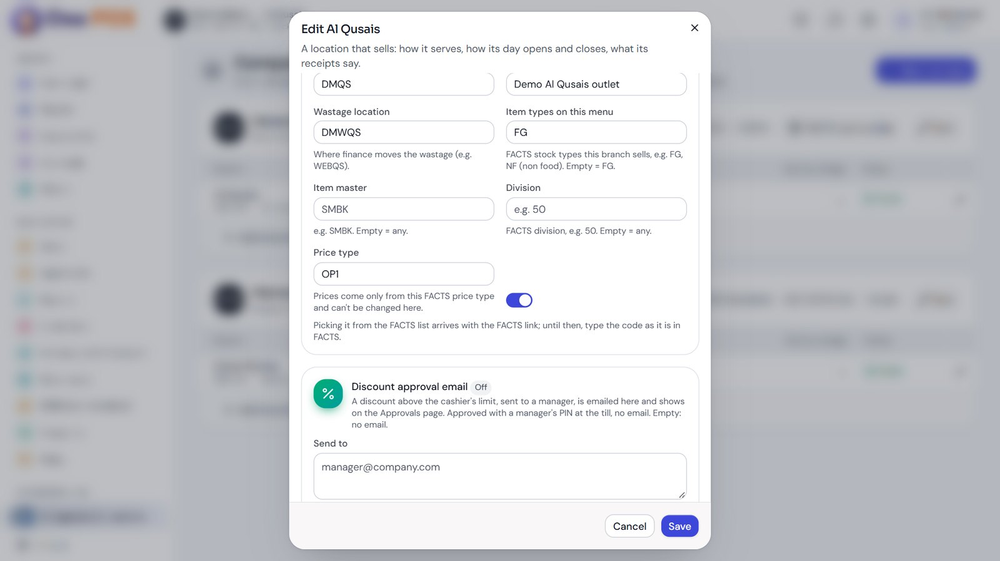
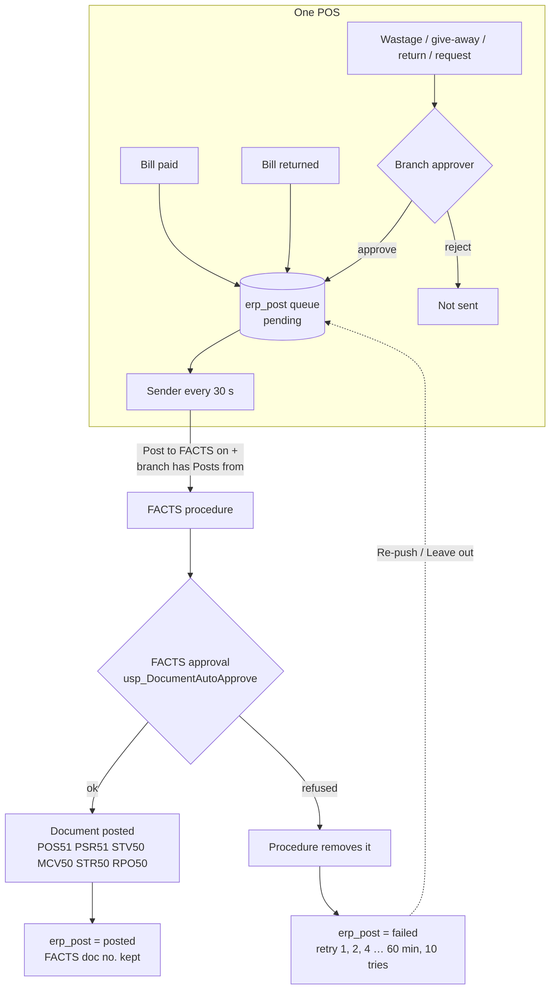
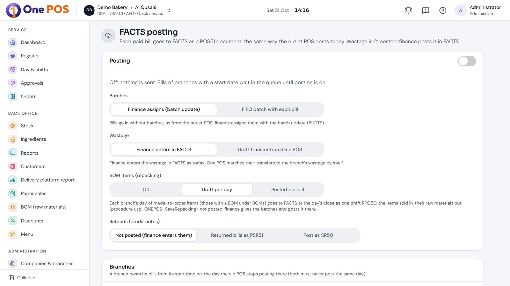

# 4. FACTS integration

FACTS (SQL Server) is the ERP of the FACTS companies (e.g. European Bakery, EBL). One POS **reads** items, prices,
stock, payment methods, deliveries and BOMs from it, and **posts** bills, returns and stock documents to it through
stored procedures. A company with the ERP set to Standalone or AWS One skips all of this.

## Connection

- Set per company by an administrator: Companies & branches → **FACTS connection**. Tested, then encrypted with ASP.NET Data
  Protection (`Erp/ErpConnections.cs`); never shown again.
- Reads open the connection with `ApplicationIntent=ReadOnly` and run SELECTs only.
- Posting uses the same connection with `ApplicationName = "One POS posting"` and calls procedures only.
- Each branch maps to a FACTS **location** (e.g. ERBQS Al Qusais), a **wastage location** (e.g. WEBQS), the item types /
  item master / division on its menu, and a **price type** (PTM). Set under Companies & branches → branch → FACTS stock location.

## What is read (`Erp/FactsSync.cs`)

| Data | FACTS source | How often |
| --- | --- | --- |
| Items | `STOCK_MASTER` of the branch's item types / master / division; sub-category (`STK_GRP2`) as menu category; unit and decimals | Hourly, or **Sync items** |
| Outlet prices | `STOCK_PRICE` of the branch's price type (`PRICE_TYPE_MASTER`), VAT added where the branch's prices are before VAT | Every 5 min, or **Sync prices** |
| Platform prices | The platform customer's price list (CPL50), newest valid list wins | With prices |
| Stock | `STOCK_LOCATION_MASTER` of the branch's location | Every 5 min, or **Sync stock** |
| Payment methods | `PAYMENT_METHOD` names starting with the location code (e.g. "ERBQS VISA CARD", "ERBQS Talabat") | Hourly, and when a location is set |
| BOMs | Outlet bills of materials (BOMO50) | With the regular sync, or **Sync from FACTS** |
| Deliveries | Stock transfers (STV50) into the branch's location, and its STR50 requests | When the Stock screen asks |
| What sold here | The location's POS documents of the last 14 days | **Switch on what sold here** |

Rules: new items arrive switched off ("New from FACTS"); items inactive or sale-blocked in FACTS switch off; a renamed item
keeps its One POS name; **FACTS prices always win** and an item without a FACTS price cannot be sold; every price change is
kept in `item_price_history` and rung-up bills keep their prices. Every run is logged in `erp_sync`.

## What is posted (`Erp/FactsPosting.cs`)

| One POS event | Queue kind | FACTS document | Procedure | Posted as |
| --- | --- | --- | --- | --- |
| Bill paid (and paper slip keyed in) | `invoice` | **POS51**, numbered with the invoice number | `usp_FQAPI_PWA_POS_SaveInvoice` (FACTS' own), or `usp_ONEPOS_SaveInvoice` (same, then FIFO batches per line) | ONEPOS |
| Whole bill returned | `refund` | **PSR51** copied from the bill's POS51, numbered with the credit note number | `usp_ONEPOS_PostReturn` | POSBAKERY |
| Bill with BOM items | `repacking` | **RPO50** repacking voucher, posted per bill (or one draft per day) | `usp_ONEPOS_PostRepacking` / `usp_ONEPOS_SaveRepacking` | POSBAKERY |
| Wastage approved | `wastage` | **STV50** location → wastage location, FIFO batches | `usp_ONEPOS_PostWastageTransfer` (or draft `usp_ONEPOS_SaveWastageTransfer`) | Approver's FACTS user |
| Return to store approved, check-in shortfall | `return` | **STV50** back to the origin location | `usp_ONEPOS_PostWastageTransfer` | Approver's FACTS user |
| Marketing give-away approved | `marketing` | **MCV50** to the marketing expense account at batch cost | `usp_ONEPOS_PostConsumption` | Marketing FACTS user |
| Stock request approved | `request` | **STR50** store → outlet | `usp_ONEPOS_PostTransferRequest` | Approver's FACTS user |

Sources of the One POS procedures are in `db/facts/`. "Posted" means FACTS' own approval framework ran
(`usp_DocumentAutoApprove` and the document's `DOCUMENT_PROCEDURES` steps), so FACTS shows the document as posted; if FACTS
refuses, the procedure removes what it saved, so nothing half-done stays.

### The invoice XML

The same XML the old outlet POS (Polaris) sends: `/data/Invoice` with invoice number and date, currency, location, gross,
net and VAT, `Party` (walk-in customer AR C0006; `BillToAddress` is required), `ReceiptDetails` per payment (ReceiptMode =
the FACTS payment method name, e.g. "ERBQS VISA CARD"; card type picked by the cashier) and `InvoiceDetails` per line
(item code, qty, unit, rate, discount, VAT). Notes:

- **Discounts go on the lines only**; the header discount is 0 and header gross is the lines' total after discount. FACTS
  books header and line discounts both, so sending both took discounts off twice (fixed 31 Oct 2026, 124 bills re-sent).
- A combo sends one line per chosen item with its own code, discount and VAT shared by amount.
- A platform's order number goes into the POS51's customer LPO field (`SAL_REFNO`).
- Document numbers are at most 20 characters (`INV-<branch code>-000001`).
- Sending the same number again makes FACTS **revise** the POS51 (old one deleted, recreated); it never doubles.

### The sender

- Runs every 30 seconds (at once when woken by a new bill) for companies with **Post to FACTS** on, and only for branches
  with a **Posts from** date. That date must be after the old POS's last day at the branch: both must never post the same day.
- Up to 50 due rows per round, oldest first. A bill waits for its own repacking voucher; a PSR51 waits for its bill's POS51.
- On failure it retries up to 10 times, waiting 1, 2, 4 … up to 60 minutes; then the row stays `failed` with its error.
- Administration → **FACTS posting** shows the queue: **Dry run**, **Push now**, **Re-push failed**, **Re-push**, **Leave out**.

### Company options (FACTS posting page)

| Option | Choices |
| --- | --- |
| Batches | Finance assigns later (batch update), or FIFO batch with each bill (`usp_ONEPOS_SaveInvoice`) |
| Wastage | Finance enters in FACTS, or draft transfer from One POS; with a branch approver it is posted on approval |
| BOM items (repacking) | Off, draft per day, posted per bill |
| Refunds | Not posted (finance enters them), returned bills as PSR51, or SR50 via a named procedure |

## Changing anything in FACTS

- One POS' procedures are created in FACTS by the business (or by a developer only with their explicit go-ahead), using
  the scripts in `db/facts/`. `tools/facts-create-proc.cs` creates a procedure and never replaces one.
- Before a new posting procedure goes live, run its rehearsal in `db/facts/tests/` (`rehearse_post_*.sql`): it posts one
  document inside a transaction and rolls it back, proving the procedure and FACTS' approval steps work.
- One-off corrections live in `db/facts/fixes/`, dated. They are run by hand in FACTS, never by the app.
- Check posting rights first: FACTS limits who may post some documents (STV50 and MCV50 "Transaction Posting" are restricted
  to named users and roles), which is why stock documents post as the approver's FACTS user.

## Cost of sales

POS51 cost in FACTS is only right after FACTS' cost recalculation. The **Gross profit** report therefore uses
qty × the batch's landed cost (`STOCK_BATCH_MASTER.BATMST_LANDED_COST_RATE`) and shows lines without a batch as "no cost yet".
