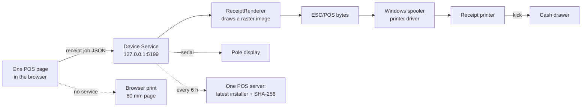

# 5. Till devices

A browser cannot drive a receipt printer or a cash drawer, so each till PC runs the **One POS Device Service**: a .NET
Windows service listening only on `127.0.0.1:5199`. The web app on that PC talks to it directly.

## What it does

| Endpoint | Job |
| --- | --- |
| `GET /status` | Version, printers installed, chosen printer and its spooler state |
| `POST /print/receipt` | Prints a receipt or credit note: drawn as a raster image (Arabic works), sent as raw ESC/POS through the Windows driver |
| `POST /print/preview` | The same receipt as an image, for the screen |
| `POST /print/test` | A test page |
| `POST /drawer/open` | Kicks the cash drawer through the printer |
| `POST /display` | Writes two lines to a serial pole display |
| `POST /update/check` | Checks for, and optionally installs, a newer version |

Kitchen tickets print through the station's printer set under Devices → Kitchen & bar.

| Source file | Role |
| --- | --- |
| `ReceiptRenderer.cs` | Draws the receipt; must match `web/src/lib/receipt-draw.ts` line for line |
| `EscPos.cs`, `RawPrinter.cs` | ESC/POS commands and raw printing via the Windows spooler |
| `PoleDisplay.cs` | Serial pole display |
| `DeviceSettings.cs` | Per-PC settings (printer, paper width 80/58 mm, drawer, pole display port) |
| `Updater.cs` | Self-update |

A printer named `file:C:\path\out.bin` writes the bytes to a file, for testing without hardware.

## Tray app

`src/OnePos.DeviceTray` starts with Windows and shows whether the service runs, the printer state, a test print and
"check for updates".

## Installer and updates

- MSI built with WiX 5 (`installer/DeviceService/`) by
  `tools/release-device-service.ps1 -Version x.y.z -WebOrigin https://ralsnahashho.dyndns.org:1000`. The server address is
  built in, so a double-click installs it. Service starts automatically and restarts if it stops.
- `deploy/release.sh` builds it with each release (skip with `SKIP_DEVICE=1` when the service did not change) and
  `onepos publish-device <env> …` publishes it per environment.
- Tills download it from **Devices** the first time. Afterwards the service checks every 6 hours with the server its web
  app came from (only that address), verifies the SHA-256 and installs quietly with msiexec. **Update by itself** can be
  switched off per PC; **Update now** forces it.
- Raise `<Version>` in `src/OnePos.DeviceService/OnePos.DeviceService.csproj` for every change (now 1.2.0).
- The MSI is not code-signed yet, so Windows SmartScreen warns on first install.

## Device status

Every PC running One POS reports each minute (`Pos/DeviceStatus.cs`): online or last seen, who is signed in, the Device
Service version, the receipt printer and its spooler state (ready, paper out, offline, error), last print and last error.
Shown under Devices → **This branch's PCs**.

## Without the Device Service

Receipts open the browser's print dialog on an 80 mm page (`web/src/lib/browser-print.ts`); the drawer cannot open.
