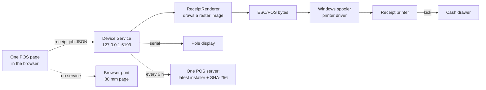
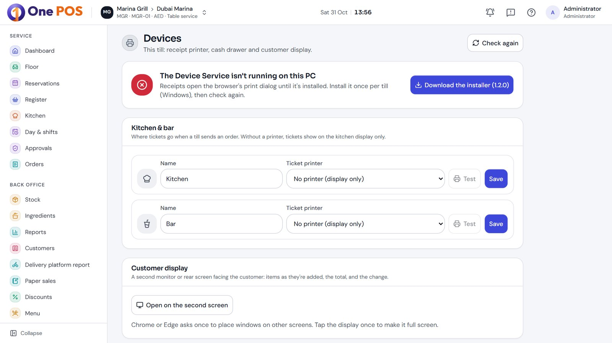

# 5. Till devices

A browser cannot drive a receipt printer or a cash drawer, so each till PC runs the **One POS Device Service**: a .NET
Windows service listening only on `127.0.0.1:5199`. The web app on that PC talks to it directly.

## What it does

| Endpoint | Job |
| --- | --- |
| `GET /status` | Version, printers installed, chosen printer and its spooler state, `signage { configured, branchId }` |
| `POST /print/receipt` | Prints a receipt or credit note: drawn as a raster image (Arabic works), sent as raw ESC/POS through the Windows driver, or, in **Windows driver** mode, printed as a picture through the printer's own driver |
| `POST /print/preview` | The same receipt as an image, for the screen |
| `POST /print/test` | A test page |
| `POST /drawer/open` | Kicks the cash drawer through the printer |
| `POST /display` | Writes two lines to a serial pole display |
| `POST /update/check` | Checks for, and optionally installs, a newer version |
| `PUT /signage` | TV screens: the web app (signed in, from an allowed address, with an `Origin` header) hands over this PC's TV token and branch; an empty token clears them |
| `GET /signage` | `{ configured, branchId, api }`; the token itself only to a program on this PC (no `Origin` header, addressed as `127.0.0.1`), i.e. the tray app, never to a web page |

Kitchen tickets print through the station's printer set under Devices → Kitchen & bar.

| Source file | Role |
| --- | --- |
| `ReceiptRenderer.cs` | Draws the receipt; must match `web/src/lib/receipt-draw.ts` line for line |
| `EscPos.cs`, `RawPrinter.cs` | ESC/POS commands and raw printing via the Windows spooler |
| `DriverPrinter.cs` | **Windows driver** mode: the receipt picture through the printer's own driver (any printer whose driver prints a Windows test page), dot for dot at 203 dpi, over several pages if the driver keeps short pages; the drawer still gets its ESC/POS kick |
| `PoleDisplay.cs` | Serial pole display |
| `DeviceSettings.cs` | Per-PC settings (printer, paper width 80/58 mm, print using ESC/POS or the Windows driver, drawer, pole display port) |
| `Updater.cs` | Self-update |
| `TrayWatchdog.cs` | Keeps the tray app running for the user signed in at the till's screen |

A printer named `file:C:\path\out.bin` writes the bytes to a file, for testing without hardware.

## Tray app

`src/OnePos.DeviceTray` starts with Windows and shows whether the service runs, the printer state, the TV screens, a test
print, "check for updates" and "Connect wireless TV". **Hide this icon** hides only the icon; the app keeps running (it shows
the TVs).

**Watchdog.** The service (only when it runs as the Windows service) checks every 10 seconds that `OnePos.DeviceTray.exe`
runs in the session of whoever is signed in at the till's own screen (the active console session) and, if not, starts it there
as that user (`WTSQueryUserToken` → `CreateProcessAsUser` on `winsta0\default`). It waits until the user's desktop is up,
does nothing when nobody is signed in, and when the tray keeps closing (5 starts in 5 minutes) waits 5 minutes before the next
try. The tray is found at `..\Tray\OnePos.DeviceTray.exe` from the service's folder (where the installer puts it).

### TV screens

The tray shows One POS TV pages on the TVs connected to the till PC (`SignageController.cs`, `TvWindow.cs`, `Displays.cs`):

1. Every 5 seconds, and at once when screens are plugged in or out, it reads `GET /signage` from the service. No token: no TV
   windows.
2. It lists the screens other than the till's own. Each gets a key that stays the same for the same TV: the monitor's device
   path from Windows' display configuration (`QueryDisplayConfig`); for a wireless (Miracast) TV, whose path can change with
   every connection, `miracast:` plus the TV's own name. The name shown is the monitor's own name (e.g. "Hisense VIDAA TV").
3. It sends them to `POST {server}/api/public/signage/screens` with the `X-Signage-Token` header. TV screens switched off for
   the branch, or a token the server doesn't know (401): all TV windows close. Server not reachable: the TVs keep playing.
4. For each TV the server answers for, one window covers exactly that screen and loads `{web}/tv?screen=<id>&t=<token>` once
   (again only when the TV's id or the token changes). The page follows the server by itself: the design when the TV is on,
   black when off.

A TV window is borderless and black, not on top, not in the taskbar or Alt+Tab, and never takes the focus from the cashier;
Alt+F4 does nothing. It uses Microsoft Edge WebView2 (part of Windows 11; on a PC without it the tray says once that TV
screens need the WebView2 Runtime) with its data in `%LOCALAPPDATA%\OnePos\TvWebView`, no right-click menu, developer tools,
zoom or browser keys, and videos may play by themselves. A page that fails or crashes reloads after 5 seconds; if the browser
itself ends, the windows start again.

**Wireless TV.** The tray remembers the name of a TV that was connected wirelessly (`%LOCALAPPDATA%\OnePos\tray.json`).
About 20 seconds after the tray starts, if that TV isn't connected, it tries once to connect it: it opens Windows' Cast panel
(Win+K), picks the TV there (UI Automation), waits up to 20 seconds, closes the panel and runs `DisplaySwitch.exe /extend` so
the TV becomes a screen of its own. **Connect wireless TV** in the tray menu does the same; with no TV remembered it opens
the Cast panel for the user to pick one. It never retries by itself.

## Installer and updates

- MSI built with WiX 5 (`installer/DeviceService/`) by
  `tools/release-device-service.ps1 -Version x.y.z -WebOrigin https://ralsnahashho.dyndns.org:1000`. The server address is
  built in, so a double-click installs it. Service starts automatically and restarts if it stops.
- `deploy/release.sh` builds it with each release (skip with `SKIP_DEVICE=1` when the service did not change) and
  `onepos publish-device <env> …` publishes it per environment.
- Tills download it from **Devices** the first time. Afterwards the service checks every 6 hours with the server its web
  app came from (only that address), verifies the SHA-256 and installs quietly with msiexec. **Update by itself** can be
  switched off per PC; **Update now** forces it.
- Raise `<Version>` in `src/OnePos.DeviceService/OnePos.DeviceService.csproj` for every change (now 1.4.0; the tray is
  1.2.0). Both programs are single self-contained files; the tray's WebView2 libraries are inside its exe.
- The MSI is not code-signed yet, so Windows SmartScreen warns on first install.

## Device status

Every PC running One POS reports each minute (`Pos/DeviceStatus.cs`): online or last seen, who is signed in, the Device
Service version, the receipt printer and its spooler state (ready, paper out, offline, error), last print and last error.
Shown under Devices → **This branch's PCs**.

## Without the Device Service

Receipts open the browser's print dialog on an 80 mm page (`web/src/lib/browser-print.ts`); the drawer cannot open.
