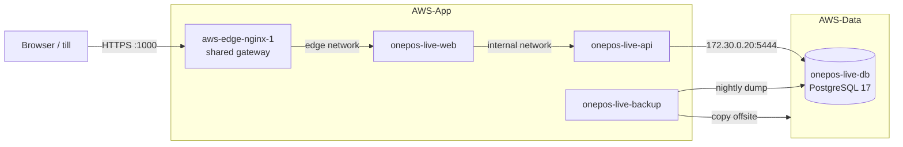
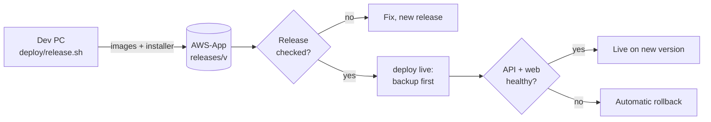

# 6. Servers and releases

The full runbook is [`deploy/README.md`](../deploy/README.md). This page is the summary.

## The live system

| | Live |
| --- | --- |
| Address | https://ralsnahashho.dyndns.org:1000/onepos |
| App server (AWS-App) | `onepos-live-api`, `onepos-live-web`, `onepos-live-backup` |
| Database (AWS-Data) | `onepos-live-db`, 172.30.0.20:5444 |
| Limits | API 1.5 GB, web 768 MB, DB 4 GB |

It runs on the SFA servers behind the shared gateway `aws-edge-nginx-1` (port 1000), routed by
`/opt/aws/edge/apps/onepos.conf`. Everything else is One POS' own: containers, databases, folders under `/opt/aws/onepos`,
ports and limits. Settings and passwords are in `/opt/aws/onepos/live/.env` (mode 600); never print or copy them.

## Docker: what runs in it and why

Every part of One POS on the servers runs in a **Docker container**: a sealed package holding the program and exactly the
software it needs, started from an **image** built once on the development PC. Docker itself is the only software One POS
needs on the servers.

### What runs where

| Server | Container | Image | What it does |
| --- | --- | --- | --- |
| AWS-App | `onepos-live-api` | `onepos-api:<version>` | The API (.NET 10, self-contained, on Debian slim) |
| AWS-App | `onepos-live-web` | `onepos-web-live:<version>` | The web app (Next.js on Node 22) |
| AWS-App | `onepos-live-backup` | `onepos-postgres:17-…` | Nightly database dump and files archive, copied to AWS-Data |
| AWS-Data | `onepos-live-db` | `onepos-postgres:17-…` | PostgreSQL 17 with pgBackRest point-in-time recovery |

Test is the same set with `test` in the names. The images are defined in `deploy/api.Dockerfile`, `web.Dockerfile` and
`postgres.Dockerfile`; how they run together is in `deploy/app/compose.yml` (AWS-App) and `deploy/data/compose.yml`
(AWS-Data).



### Why Docker

| Reason | What it gives One POS |
| --- | --- |
| **The same image on test and live** | A release is tested on test and the identical image goes to live; only the settings file (`.env`) differs. "It worked on test" means it will work on live |
| **Repeatable builds** | Each image is built from a file in the repository with fixed versions (.NET 10 SDK, Node 22, PostgreSQL 17), so any release can be rebuilt the same way |
| **Separate from SFA on shared servers** | One POS has its own containers, networks, data folders, ports and database roles, so it can't disturb the SFA system on the same servers, or be disturbed by it |
| **Resource limits** | API 1.5 GB / 2 CPUs, web 768 MB / 1 CPU, database 4 GB: one part running away can't starve the server |
| **Safe deploys and rollback** | Every version stays on the server as its own image. `deploy live` takes a backup, starts the new containers, and goes back to the old image by itself if the health checks fail; `onepos rollback live` is one command |
| **Health checks** | Each image checks itself (`/health` for the API, the sign-in page for the web app); Docker restarts a container that stops (`restart: unless-stopped`) |
| **Least privilege** | The API and web containers run as an unprivileged user, not root. Only the web app is on the gateway's network; the API and database are not reachable from outside |
| **Nothing installed on the servers** | No .NET, Node or PostgreSQL installed on the host, so server updates can't break One POS and One POS can't break the server |
| **Easy to move** | Everything a container keeps lives in one data folder per environment, and the database address is a setting, so moving to a new server is "copy the folder, start the containers" or a restore from backup |
| **Logs kept in bounds** | Container logs rotate at 5 × 20 MB, so they never fill the disk |

### On the development PC

Docker Desktop runs the local database for development (`start-dev.ps1`), builds the release images
(`deploy/release.sh`), and starts throwaway databases for the data dictionary and the query timings
(`tools/docs/data-dictionary.mjs`, `db-benchmark.mjs`).

Docker Desktop keeps its data in one disk file, which grows with every release build and never shrinks by itself. Clear the
build cache now and then (`docker builder prune -af`) and remove old release images; the space only comes back on the
drive after the disk file is compacted (administrator, Docker stopped, `diskpart` → `compact vdisk`). If Docker's disk runs
full, Docker turns read-only and running databases crash.

## Releasing

From the development PC, in **Git Bash** (on Windows, PowerShell's `bash` is WSL and fails):

```bash
deploy/release.sh 2026.10.31-1-xx                                  # build, copy and load on both servers (10+ minutes)
# check the release first (see deploy/README.md)
ssh aws-app /opt/aws/onepos/bin/onepos deploy live 2026.10.31-1-xx  # the same release on live
```



- Version = date, sequence and a short suffix per person or session, so parallel work never reuses a number.
  Check `/opt/aws/onepos/deploy.log` for what is live before deploying.
- A release = the API image, the web image (built with its path prefix), the database image
  when `deploy/data` changed, and the Device Service installer.
- `deploy live` takes a backup, switches, and waits for the API (which applies migrations at start) and web to report
  healthy; if not, it rolls back by itself.
- `onepos rollback live` goes back one version. If the failed release already changed the database, restore the dump taken
  just before it (`onepos restore live <dump>`, named in the deploy log).
- Each release keeps about 0.4 GB in `deploy/releases/` on the PC; check free space on C: first. If the build finished but
  copying failed (e.g. SSH blocked), run `deploy/copy-release.sh <v>`.

## Access

- SSH access to `aws-app` and `aws-data` is set up in `~/.ssh/config` on the development PC; ask the system administrator
  for access.
- Many SSH connections in a row can get port 22 blocked for a while; combine commands into few calls.

## Backups

| What | Where | Kept |
| --- | --- | --- |
| Nightly database dump + files archive | AWS-App `/opt/aws/onepos/backups/live`, copied to AWS-Data `offsite/` | 14 days |
| Point-in-time (live) | AWS-Data `live/pgbackrest` | 2 weekly full, nightly differentials, every WAL |
| Before every live deploy | Dump named in `deploy.log` | With the nightly ones |

`onepos status` (AWS-App) and `onepos-db status` (AWS-Data) show versions, health and the last backups.
