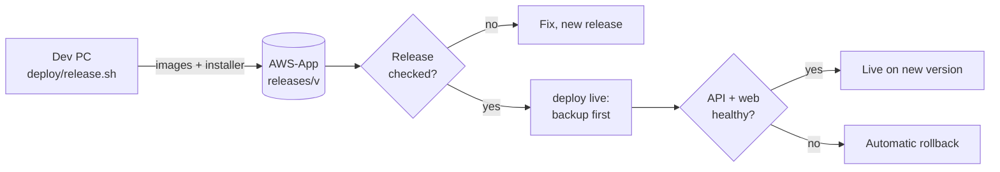

# 6. Servers and releases

The full runbook is [`deploy/README.md`](../deploy/README.md). This page is the summary.

## The live system

| | Live |
| --- | --- |
| Address | https://ralsnahashho.dyndns.org:1000/onepos |
| App server (AWS-App) | `onepos-live-api`, `onepos-live-web`, `onepos-live-backup` |
| Database (AWS-Data) | `onepos-live-db`, 172.30.0.20:5444 |
| Limits | API 1.5 GB, web 768 MB, DB 4 GB |

It runs on the SFA servers behind the shared gateway `aws-edge-nginx-1` (port 1000), routed by
`/opt/aws/edge/apps/onepos.conf`. Everything else is One POS' own: containers, databases, folders under `/opt/aws/onepos`,
ports and limits. Settings and passwords are in `/opt/aws/onepos/live/.env` (mode 600); never print or copy them.

## Releasing

From the development PC, in **Git Bash** (on Windows, PowerShell's `bash` is WSL and fails):

```bash
deploy/release.sh 2026.10.31-1-xx                                  # build, copy and load on both servers (10+ minutes)
# check the release first (see deploy/README.md)
ssh aws-app /opt/aws/onepos/bin/onepos deploy live 2026.10.31-1-xx  # the same release on live
```



- Version = date, sequence and a short suffix per person or session, so parallel work never reuses a number.
  Check `/opt/aws/onepos/deploy.log` for what is live before deploying.
- A release = the API image, the web image (built with its path prefix), the database image
  when `deploy/data` changed, and the Device Service installer.
- `deploy live` takes a backup, switches, and waits for the API (which applies migrations at start) and web to report
  healthy; if not, it rolls back by itself.
- `onepos rollback live` goes back one version. If the failed release already changed the database, restore the dump taken
  just before it (`onepos restore live <dump>`, named in the deploy log).
- Each release keeps about 0.4 GB in `deploy/releases/` on the PC; check free space on C: first. If the build finished but
  copying failed (e.g. SSH blocked), run `deploy/copy-release.sh <v>`.

## Access

- `aws-app` is reached through the Hyper-V host (`aws-hyperv`, 172.14.110.100:2222) as a jump; `aws-data` through `aws-app`.
  See `~/.ssh/config` on the development PC.
- Many SSH connections in a row can get port 22 blocked for a while; combine commands into few calls.

## Backups

| What | Where | Kept |
| --- | --- | --- |
| Nightly database dump + files archive | AWS-App `/opt/aws/onepos/backups/live`, copied to AWS-Data `offsite/` | 14 days |
| Point-in-time (live) | AWS-Data `live/pgbackrest` | 2 weekly full, nightly differentials, every WAL |
| Before every live deploy | Dump named in `deploy.log` | With the nightly ones |

`onepos status` (AWS-App) and `onepos-db status` (AWS-Data) show versions, health and the last backups.

## Source code

GitHub `aws-dushan/aws_pos`, pushed over the SSH alias `github-work`.
