# About this manual

This manual covers every One POS user, from cashier to administrator, and is organised by task: find the job you want to do, then follow the steps.

One POS is the restaurant point of sale for the group's companies and branches. It runs in a web browser, on the till and in the back office, and posts sales to FACTS. What you see depends on your role and on the branch chosen in the header.

| Role (as set up for a new company) | Mostly uses |
| --- | --- |
| Cashier | Register, Orders, Day & shifts (own shift), Customers |
| Waiter | Floor, Register |
| Kitchen | Kitchen display, Stock (wastage) |
| Supervisor | Everything a cashier does, plus voids, refunds, no sale, reports |
| Branch manager | Everything at the branch except users and reopening a day |
| Head office | Everything, every branch |
| Finance | Reports, FACTS posting, finance invoices |

Roles can be changed by an administrator (see Admin → Users and Roles), so your menu may show more or fewer screens than listed here.

The screenshots come from a demo restaurant ("Marina Grill · Dubai Marina") with made-up data, never from a live branch.

# Getting started

There are two ways in: back-office staff sign in with a user name and password, cashiers sign in at a till with a PIN of at least 4 digits.

## Sign in to the back office

1. Open One POS in the browser (live: `https://ralsnahashho.dyndns.org:1000/onepos`).
2. Type your user name and password, then **Sign in**. User names are not case-sensitive.
3. The first time, you are asked to choose a new password: at least 8 characters, letters and digits.

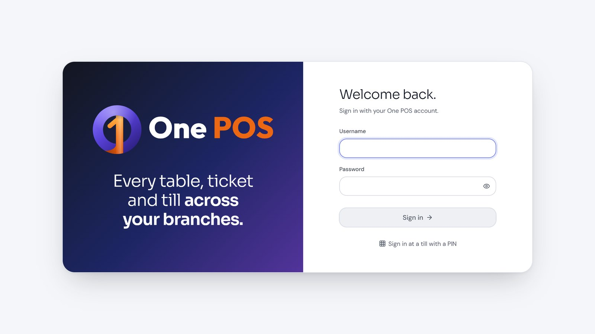

To change your password later: click your name at the top right → **Change password**.

## Sign in at a till

A till is a PC that a manager has set up for one register (user menu → **Use this device as a till**, then pick or create the register, e.g. T3 · Till 3).

1. On the till, the screen shows **Enter your PIN**.
2. Type your PIN on the pad and tap **Sign in**.
3. If the till says **This device isn't a till yet**, ask a manager to set it up with **Manager sign-in**.

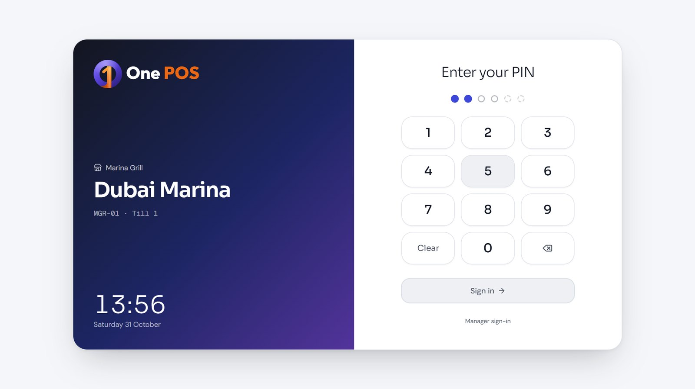

Too many wrong PINs lock the pad for a few minutes; a manager can reset a PIN under Users.

## The header

| Item | What it does |
| --- | --- |
| Company › Branch | Picks the branch you are working in. Every page (menu, customers, reports, stock) follows this branch. |
| Shield icon | Approvals waiting for you, with a count. |
| Newspaper icon | Daily summaries and alerts for your branches. |
| Report a problem | Sends a problem report, with a screenshot, to the administrators. |
| ? | Keyboard shortcuts and help. |
| Your name | Change password, dark theme, reduce animations, use this device as a till, sign out. |

## The main menu

The menu on the left is grouped into **Service** (Dashboard, Floor, Reservations, Register, Kitchen, Day & shifts, Approvals, Orders), **Back office** (Stock, Ingredients, Reports, Customers, Vouchers & loyalty, Delivery platform report, Paper sales, BOM, Discounts, Menu, Tables & floors) and **Administration**. You only see the screens your role allows, and some only appear when the branch uses them (Floor and Reservations need table service, Kitchen needs the kitchen switch). Collapse the menu with the arrow at its foot; on a phone it moves to the bottom.

## The dashboard

The home page shows today's sales, live, compared with the same time yesterday. Cashiers see their own register; managers see the whole branch.

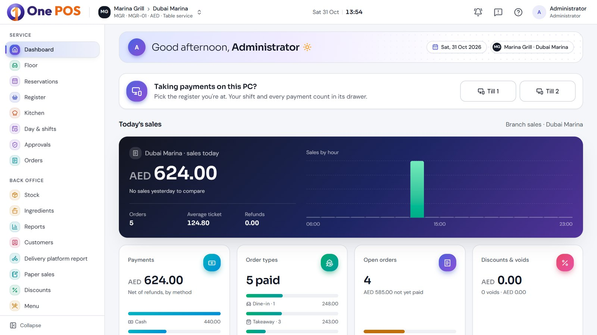

# Cashier

A cashier's day is: open your shift with the float, take orders and payments on the Register, then close your shift with a blind count. The till takes no payment until your shift is open.

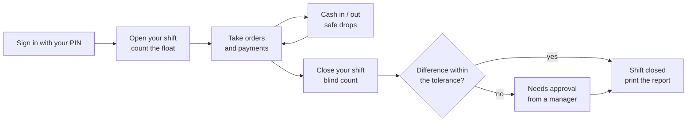

## Open your shift

1. On the Dashboard, Register or Day & shifts, find **Open your shift**. On a back-office PC you are first asked **Taking payments on this PC?**: pick the register.
2. Tap each denomination (1000 down to the 0.25 coin) and type how many you have. **Total** adds them up.
3. Tap **Open shift · amount**. If the float differs from the usual one, One POS warns you and notes it.

You can have only one open shift, on one register. Where the branch shares one drawer, you simply sell.

## Take an order

1. Open **Register** and pick **Takeaway** (counter order), **Delivery** (name, phone, address) or **Dine-in** (opens the Floor to seat a table). Orders already started are listed under **Open orders**.

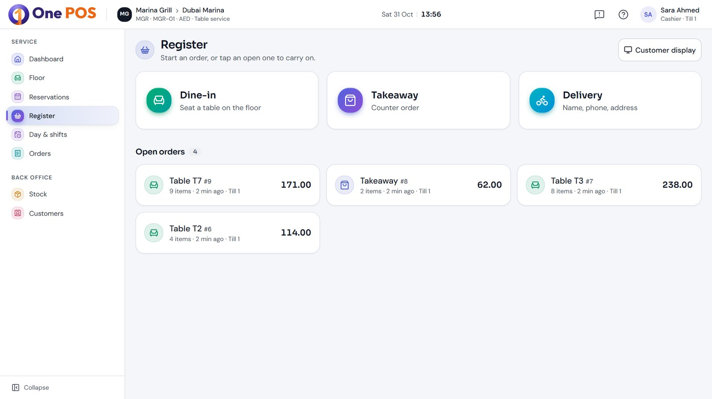

2. Tap item tiles to add them. Use **Search the menu** or the category tabs.
3. Items marked **Options** or **Combo** open a dialog: fill the **Required** groups, add a **Kitchen note (optional)**, then tap **Add · AED x**.

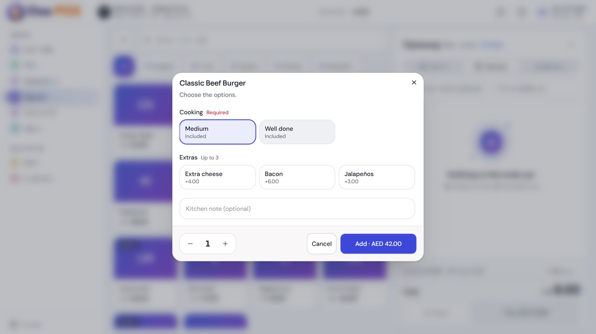

4. Items sold by weight (KG, LTR) ask **How much, in kg?**: type the amount and tap **Add**.
5. To change a line, tap it: use **− / +**, **Note**, **Discount** or the bin.

| Tile shows | Meaning |
| --- | --- |
| Sold out today | Cannot be sold today. |
| No price yet | FACTS has no price for it at this branch: it cannot be sold. Tell your manager. |
| Out of ingredients | Not enough stock for its recipe (branch rule Block). |
| Ingredients low / Only N left | A warning only: you can still sell. |

Once an item has gone to the kitchen, its note cannot change and its quantity cannot go below what was sent. Removing it is a void and needs a supervisor (**This went to the kitchen. Ask a supervisor to void it.**).

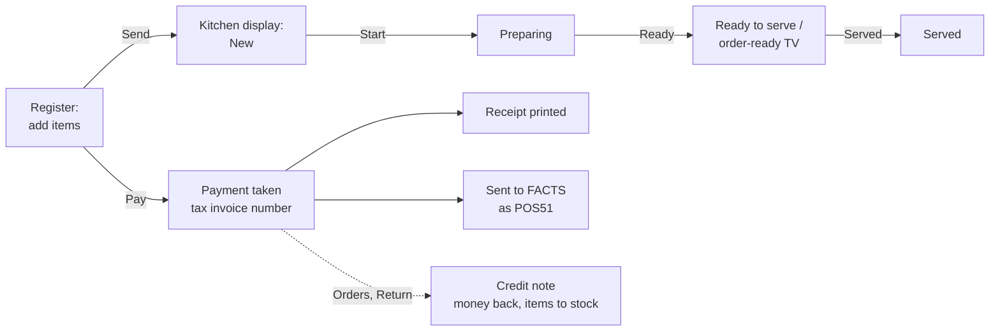

## Delivery and platform orders

- **Own delivery** needs the customer's **Phone** and **Delivery address** before it can be paid.
- For Talabat, Deliveroo, Careem and other platforms, tap the platform's chip and type the **platform order number (needed)**. No phone or address is needed: the platform delivers. The platform's own prices apply.
- A platform deal goes under the platform's **offer** chip: **We pay** (a discount on our bill) or **the platform pays**.
- The platform chip and offer lock once money has been taken.

## Customers

A customer is optional except for own delivery. In **Customer (optional): name or phone**, type at least 4 digits or 3 letters and tap the match to see visits, spend, points and notes (such as allergies). A new phone with a name becomes a customer when the order is paid. Customers belong to one branch.

## Give a discount

1. Tap the **Discount** chip by the subtotal (whole bill), or **Discount** on a line (one item).
2. Tap a ready-made discount, or under **Type a discount** pick **% off** or **AED off**, add a **Reason**, and tap **Apply**.
3. If it is over your role's limit, **Manager approval** opens (see below).

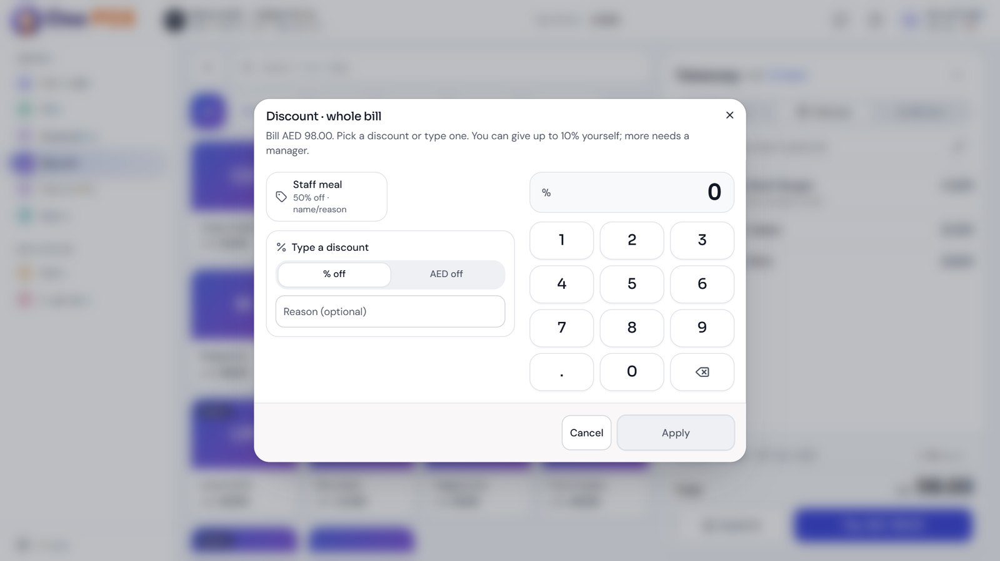

**Remove discount** takes it off. A customer with a pre-approved discount gets it automatically.

## Send, bill and pay

- **Send (N)** sends new items to the kitchen (only where the branch has a kitchen). Paying also sends anything not yet sent.
- **Bill** (dine-in) prints the bill marked **BILL · NOT PAID YET**.
- **Pay AED x** opens **Take payment**.

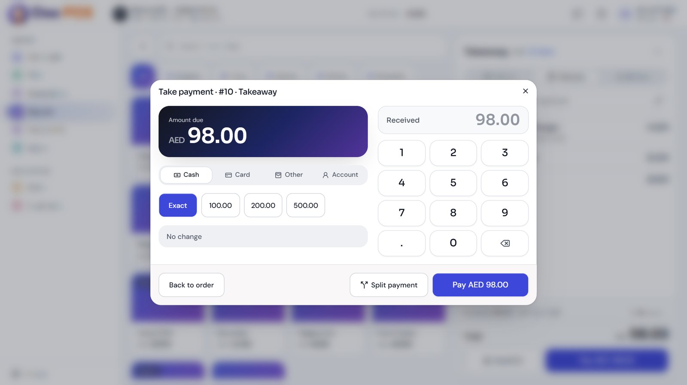

| Method | What to do |
| --- | --- |
| Cash | Tap **Exact** or a note, or type the amount. **Change to give** shows; the drawer opens. |
| Card | Pick the card type (VISA, MASTER…); optionally the approval code or last 4 digits. |
| Voucher | Type the **Voucher code**, then **Use x**. |
| Points | Customer's loyalty points, usable from the company's minimum. |
| Account | Charge to a **Customer account**. |
| Platform | Platform orders: the platform pays us. |
| Other | Any other agreed method. |

- Paying less than due is a part payment: **Take AED x**, then take the rest.
- **Split payment** adds several parts (e.g. cash and card) and takes them together.
- A 0.00 bill (e.g. 100% complimentary) shows **Complete · nothing to pay**.

After payment the receipt prints and a message says **Paid. Give AED x change.** with a **Receipt** button. Without a receipt printer, the receipt opens on screen with **Print**.

## More options (⋯)

| Option | Use it to |
| --- | --- |
| Park & start another | Keep this order open and start a new one. |
| Split bill | Move chosen items to a separate bill or another table (before any payment). |
| Move or join tables / Merge another table's order | Dine-in table changes. |
| No sale (open drawer) | Open the drawer without a sale; pick a reason. Shown on the Z report. |
| Void order | Cancel an unpaid order. Needs a supervisor once items were sent. |

Only one till edits an order at a time. Another till sees **Open on …** and can tap **Take over**.

## Manager approval

When something is over your limit (a discount, a cash out, a refund of an earlier day), the **Manager approval** window offers three ways:

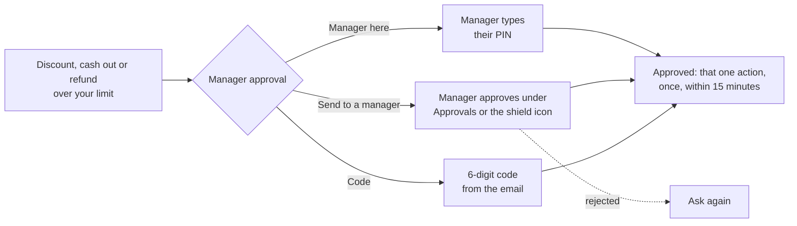

1. **Manager here**: the manager types their PIN and taps **Approve**.
2. **Send to a manager**: tap **Send request** and wait. The manager approves under Approvals or the shield icon. If rejected, you can **Ask again**.
3. **Code** (discounts only): the 6-digit code from the approval email, valid once, for 24 hours.

An approval covers that one action, once, within 15 minutes. You cannot approve your own request.

## Reprint a receipt or return a bill

1. Open **Orders**. Filter by **All / Open / Paid / Refunded / Voided** or search by number, table, name or phone.

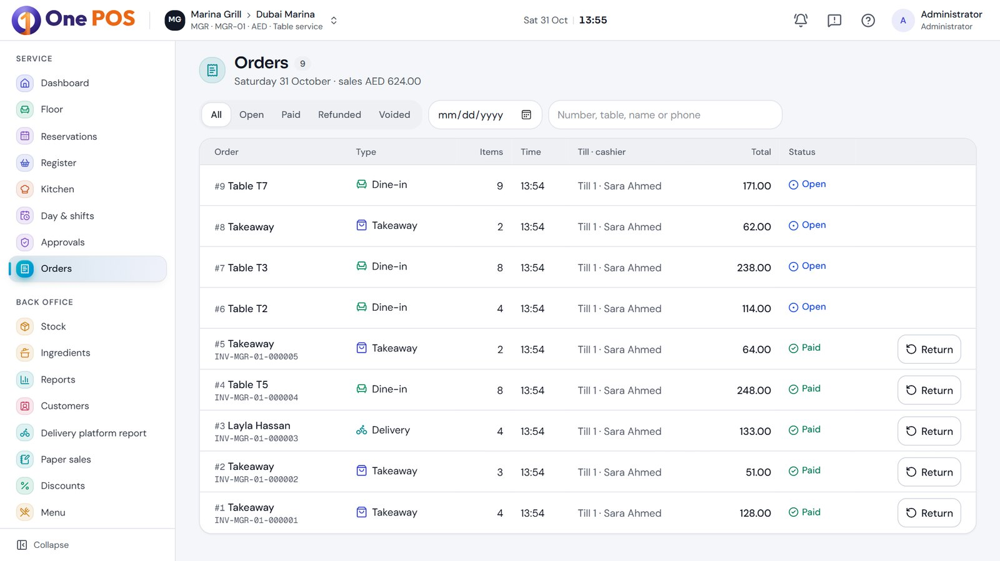

2. Tap a paid order, then **Print** to reprint.
3. To return it, tap **Return**, pick the reason (e.g. **Wrong item**, **Food quality**, **Charged twice**) and tap **Return AED x**.

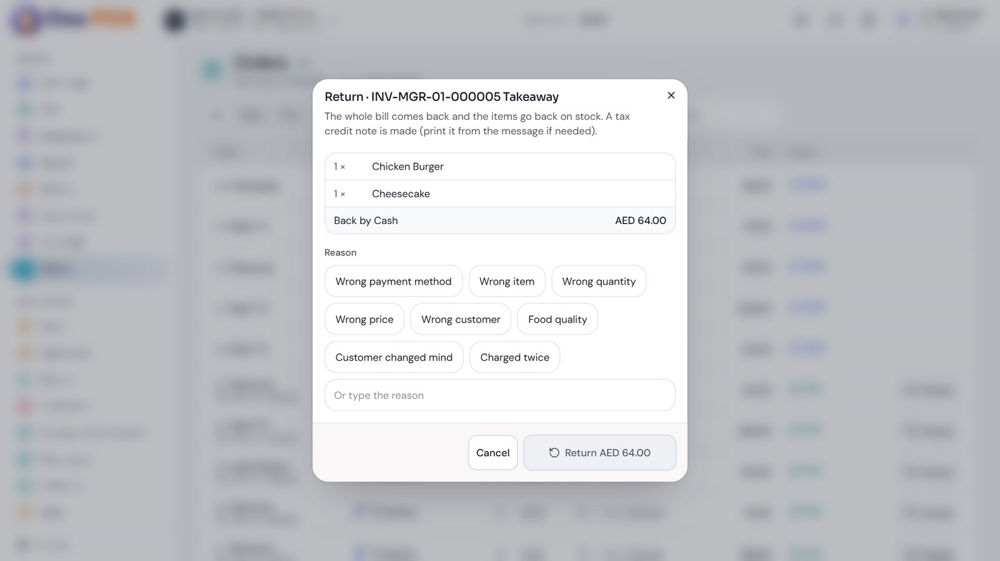

The whole bill is returned: each payment goes back the way it was paid, the items go back on stock, and a tax credit note is made (open it from the **Credit note** button). The same business day needs no approval; an earlier day needs a manager. A bill already partly refunded cannot be returned again.

## Cash in and out

With your shift open, tap **Cash in / out**, pick a tab, a reason, the amount, then **Record**.

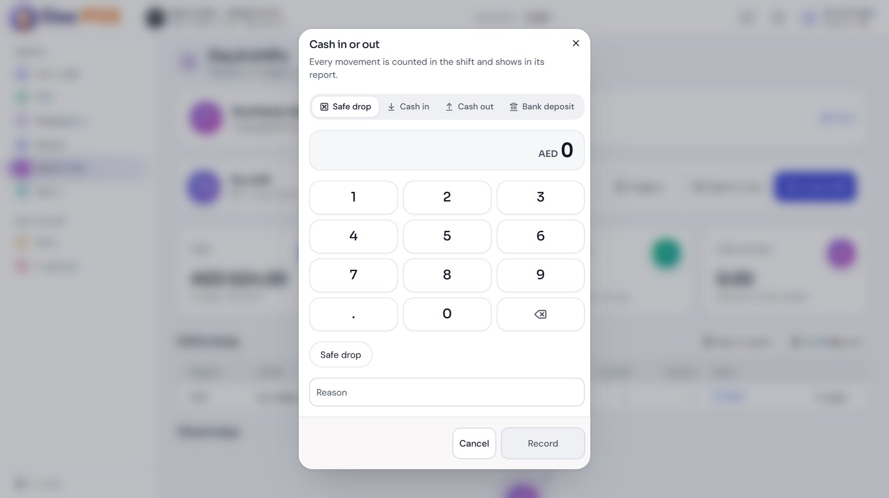

| Tab | Reasons |
| --- | --- |
| Safe drop | Cash moved to the safe. |
| Cash in | Change from the safe, float top-up. |
| Cash out | Supplier paid, petty cash, staff advance. Over your limit needs approval. |
| Bank deposit | Cash taken to the bank, with the bag or slip number. |

## Close your shift

1. Tap **Close shift** (or your name → **Close my shift**).
2. Count the drawer by denomination. You do not see the expected amount first (blind count).
3. Tap **Close shift · x**. The variance shows now; outside the branch tolerance it **Needs approval** from a manager.
4. Print your shift report with **Print**.

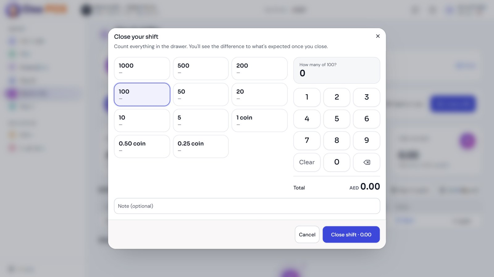

**X report** shows your shift so far without closing it.

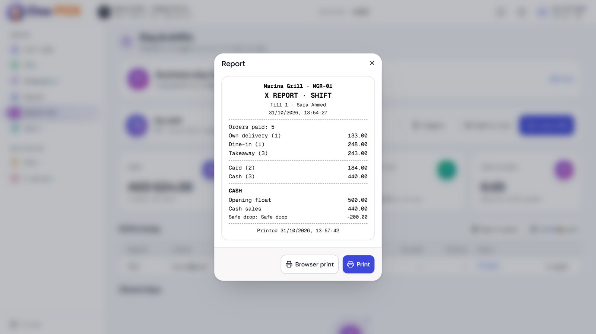

# Kitchen & floor

The kitchen works from the Kitchen display; waiters work from the Floor. Both only appear at branches that use them (kitchen switch, table service).

## Kitchen display

1. Open **Kitchen**. Pick your station at the top: **All**, **Kitchen** or **Bar**.
2. New tickets arrive in **New** with a chime. Tap **Start** when you begin, **Ready** when done, **Served** when it leaves the pass.
3. A ticket's timer turns amber at 10 minutes and red at 20.

- A red ticket reading **CANCELLED: don't make, or stop** means the order or item was voided: tap **Got it**.
- The printer icon reprints a ticket.
- A ticket served by mistake can be brought back from **Just served** within 15 minutes.
- **Chime on / Muted** switches the sound.

## Seat a table

1. Open **Floor**. Tables show as **Free**, **Seated**, **Bill** (bill printed) or **Reserved**.
2. Tap a free table, enter the number of guests and tap **Seat N & order**. The Register opens on that table.
3. Tap a busy table to open its order.

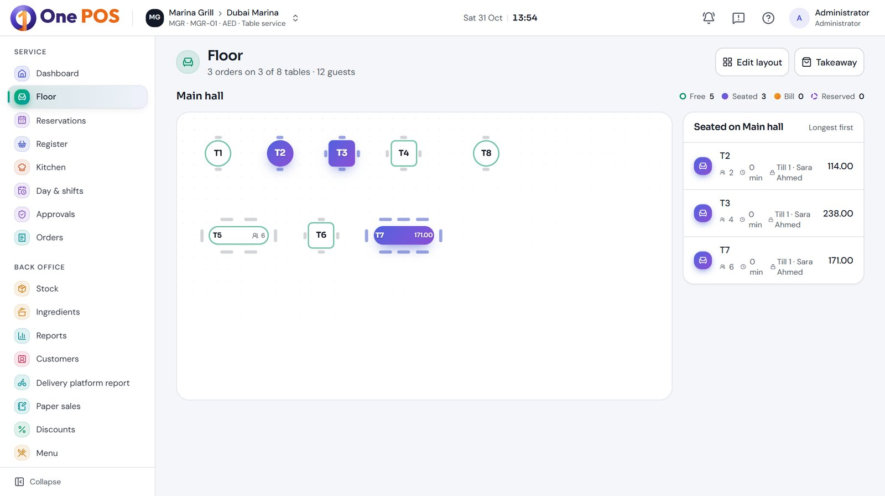

**Reserve** holds a free table; **Release** frees it. **Seated on (floor)** lists busy tables, longest first. Moving, joining and merging tables needs the tables right (Waiter and Cashier roles have it).

## Reservations

1. Open **Reservations** and tap **New booking**.
2. Fill **Name**, **Phone**, **Date**, **Time**, **For** (how long), **Guests** and **Tables to hold**, then **Book**.
3. When the guests arrive, tap **Seat** (or **Seat booking** on the Floor, shown in the two hours before).

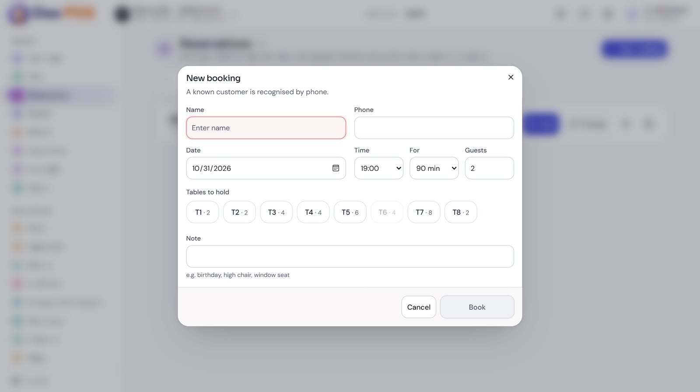

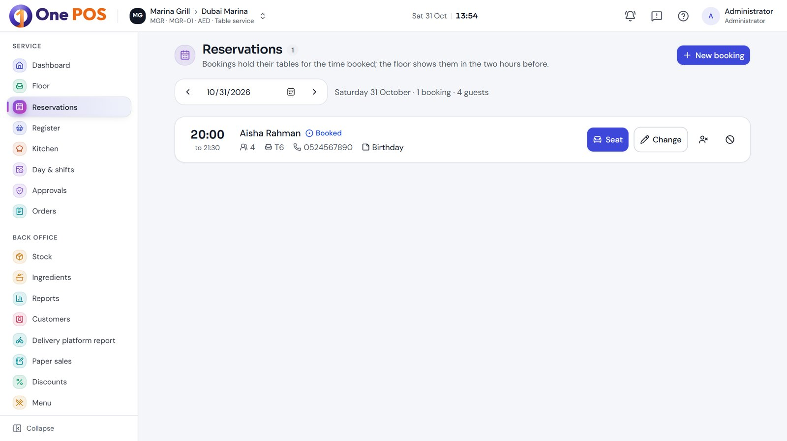

A table cannot be booked twice for overlapping times. Use the row icons for no-show or cancel; **Restore** brings a booking back.

## Order-ready TV

The TV at the counter shows takeaway and delivery numbers under **Preparing** and **Ready to collect**, in English and Arabic, with a chime. Tap the screen once to go full screen and allow sound. Depending on the branch setting, numbers turn ready by themselves (kitchen finishes, or on payment) or when the cashier taps them in the **Tap when ready** strip on the Register. Ready numbers leave by themselves after a few minutes.

## Customer display

On the till's second screen, open **Customer display** from the Register. It shows a welcome screen or pictures between orders, the lines and total during an order, and **Thank you** with the change after payment.

# Manager

Managers run the branch's day, keep the menu and stock right, answer approvals and read the reports. Everything here works on the branch chosen in the header.

## Open and close the business day

1. Open **Day & shifts** and tap **Open the day** (branches on Manual day control; Automatic branches open and close on their schedule).
2. During the day, watch **Shifts today** and approve any shift under **Variances waiting for approval** with a note.
3. At the end, make sure every shift is closed (One POS names any still open), then tap **Close the day**. The Z report is kept and the day locks.

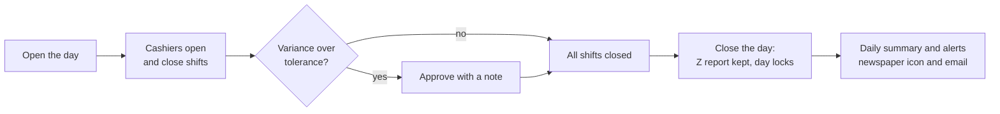

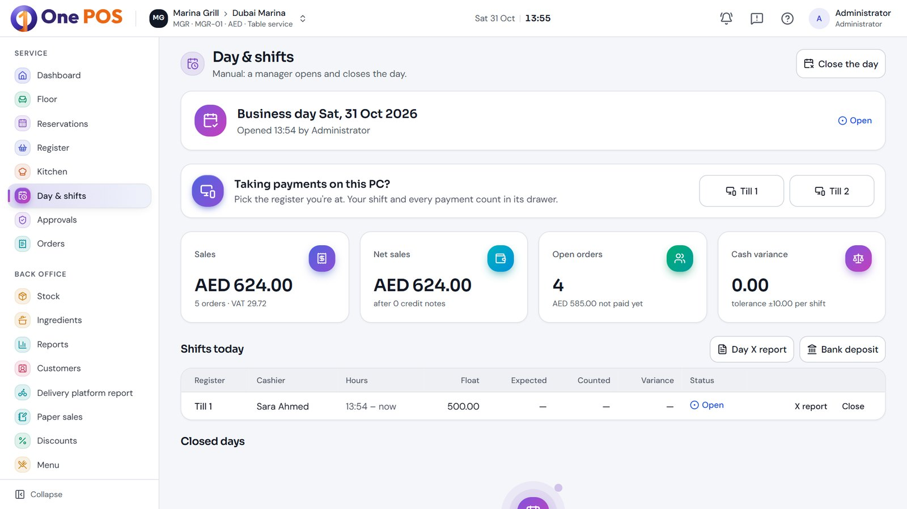

**Day X report** shows the day so far. **Closed days** lists past days with their **Z report**. **Reopen** works only on the last closed day and needs the reopen right (Head office).

## Approvals

The shield icon in the header shows how many requests are waiting. Open **Approvals**:

- **Till requests** (discount, refund, cash out): **Approve** or **Reject**. You cannot approve your own request, and only within your own limits.
- **Wastage and marketing to approve**, **returns** and **Stock requests to approve**: shown only to that branch's named approver. Tick the lines (or **Select all**), correct quantities if needed, then **Approve and post to FACTS** or **Reject** with a reason. Items waiting 12 hours or more show in red.

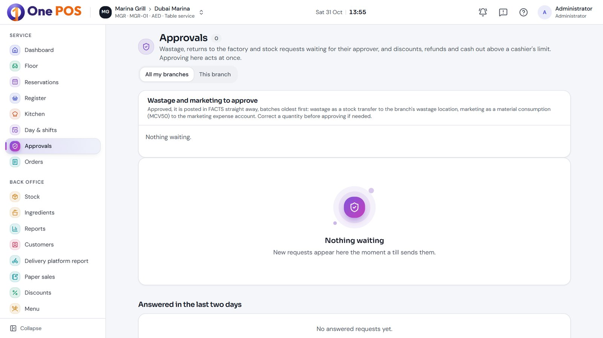

## Menu

Items, their codes and their prices come from FACTS. One POS decides what each branch sells and adds combos and options.

1. Open **Menu**. The view shows **Sold here**, **New from FACTS**, **No price** or **All items**.
2. To sell an item here, tap **Sell here**; to stop, **Don't sell here**. **Sold out** hides it for today only; **Back on** returns it.
3. **Switch on what sold here** switches on everything the branch sold in FACTS in the last 14 days.
4. **Sync items**, **Sync stock** and **Sync prices** read FACTS now (otherwise items hourly, stock and prices every 5 minutes).

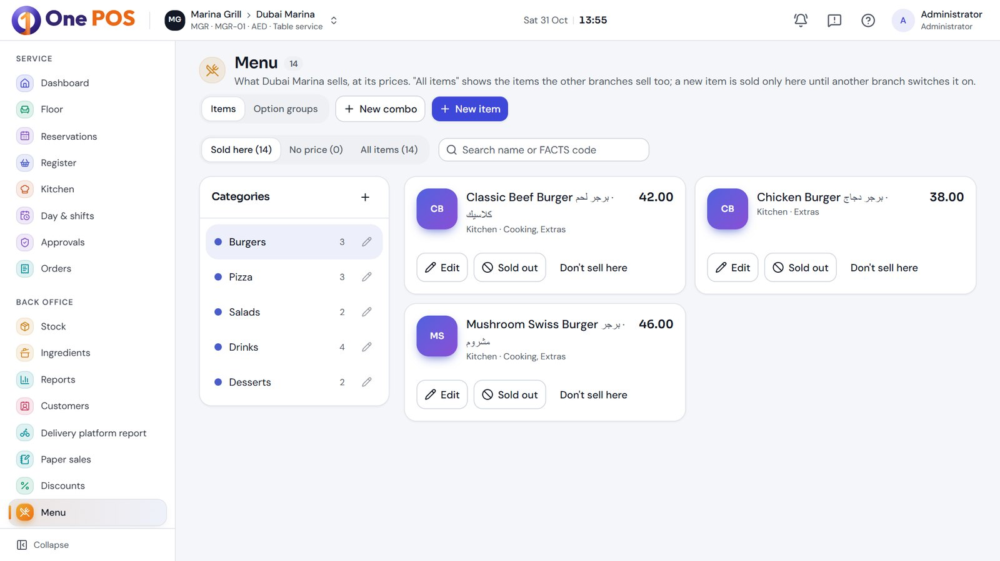

Prices cannot be typed for FACTS items: **Price at (branch)** comes from the branch's FACTS price type. To change a price, change it in FACTS. An item with no FACTS price cannot be sold. **Price history** shows every change.

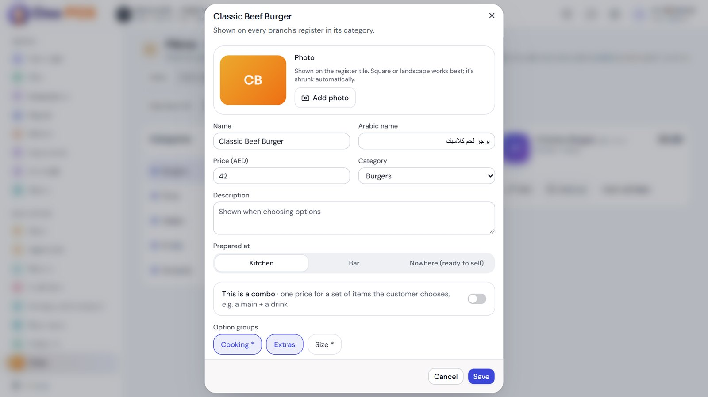

## Combos and option groups

1. Under **Option groups**, tap **New group**. Set **Must choose** (Optional or Required) and **At most**, then **Add option** for each choice, linking it to a menu item.
2. Tap **New combo**, give it a **Name** and **Category**, tap the groups under **Combo choices**, and save.

A combo is priced by its choices. FACTS receives one line per chosen item, at the price set on the choice.

## BOM (raw materials)

**BOM · raw materials** lists the bills of materials of items made at the branch. They come from FACTS outlet BOMs: to change one, change it in FACTS, then tap **Sync from FACTS**. An item with a BOM sells without stock of its own; its raw materials go to FACTS as a repacking voucher (RPO50).

## Discounts

Open **Discounts**.

- **Promotions** apply by themselves at the till: choose what it **Gives** (% off, AED off each, Fixed price), what it is **On**, the dates, days and times, the **Branches** and the **Orders** it covers.
- **Cashier discounts** are the list cashiers pick from: % or AED, whole bill or one item, and **Who can give it**.

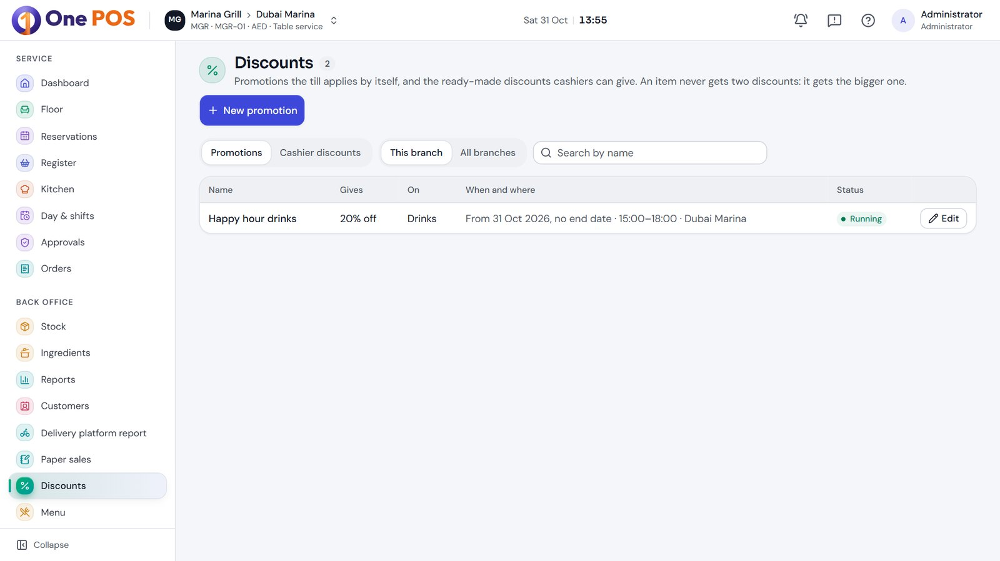

An item never gets two discounts: it gets the bigger one.

## Customers

**Customers** lists this branch's customers. **New customer** takes name, phone, email, delivery address and notes (shown at the till, e.g. allergies). With the pre-approve right, set a **Pre-approved discount** (e.g. 100% Owner guest, optionally **Until** a date): it then applies with no approval.

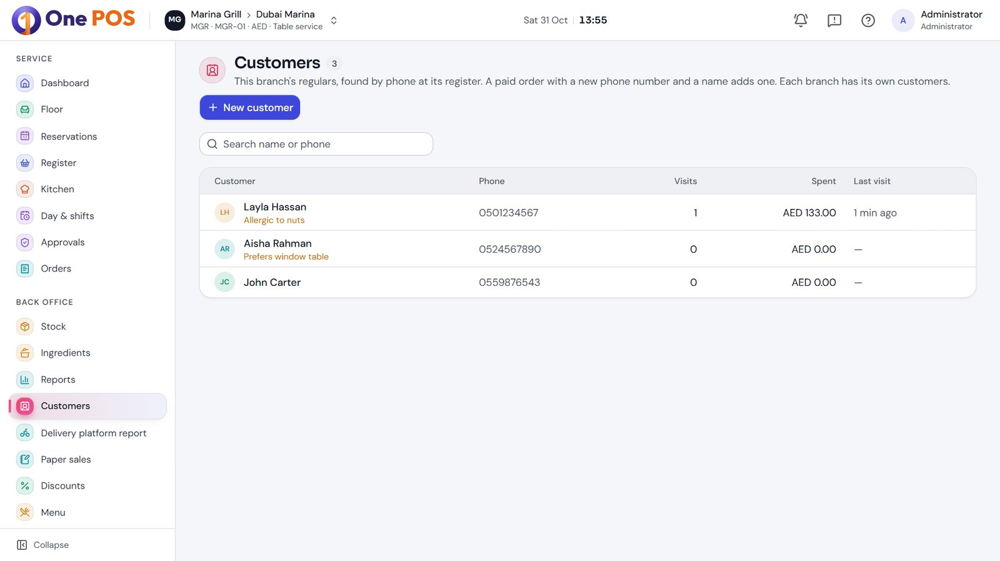

## Vouchers & loyalty

Shown only when switched on for the company. **Issue voucher** takes a value, why (Goodwill, Promotion, Sold) and an optional expiry, then prints the code. For a sold voucher, take the money at the till as an order first. **Cancel voucher** stops one. The page shows open vouchers, money still to be spent and points held.

## Stock

Open **Stock**. Its tabs depend on the branch's settings.

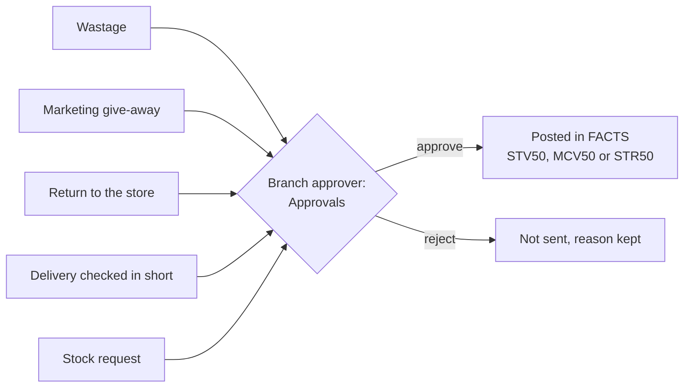

| Tab | What to do | What happens in FACTS |
| --- | --- | --- |
| Wastage | **Find the item**, quantity, reason (Expired, Damaged, Quality, Machine calibration…), **Record**. | After the approver approves: a posted transfer (STV50) to the wastage location. |
| Marketing | **Record a give-away** with a reason (tasting, promotion, influencer, gift). | After approval: a material consumption (MCV50) to the marketing account. |
| Requests | Pick the **Store** and **Needed by**, add items, then **Send for approval** (or **Save draft**). | After approval: a posted stock request (STR50) to the store. |
| Deliveries | Tap **Check in**, enter what was received per line, then **Check in**. | Anything short goes back to where it came from as a return, after approval. |
| Returns | **Return an item**: find it, quantity, reason, **Send for approval**. | After approval: a posted transfer (STV50) back to where its last delivery came from. |

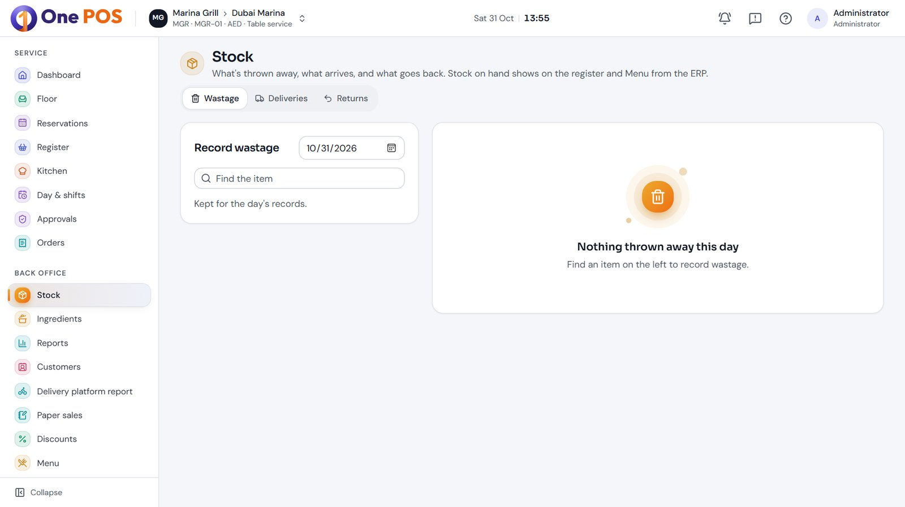

A wastage entry can be taken off the same day by whoever recorded it or by a manager, until it is approved. **Undo check-in** (manager, with a reason) changes only One POS, never FACTS.

## Ingredients

For branches using One POS recipes: **Receive** deliveries (a new cost per unit becomes the cost), record **Waste**, and **Count** the shelves (the difference is kept). **Food cost** and **Usage** show cost against sales. Recipes are edited from Menu → item → **Recipe**.

## Reports

Open **Reports**, pick **This branch** or **All my branches** and the dates (**Today**, **7 days**, **30 days**, **This month**). Every table sorts, filters and exports to Excel, CSV or PDF.

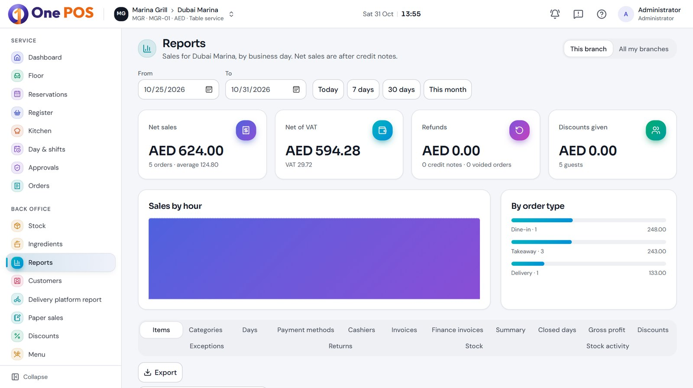

| Tab | Shows |
| --- | --- |
| Items, Categories, Days | What sold, by item, category or day |
| Payment methods, Cashiers | Money taken and refunded |
| Invoices | Every bill with its FACTS status (**Not in FACTS yet** filter) |
| Discounts | Each discount by kind |
| Exceptions | Discounts, voided orders and items, refunds, no-sales, with who did and approved each |
| Returns | Credit notes with their PSR51 number |
| Stock, Stock activity | Stock now; wastage, marketing, requests, deliveries and returns over the days |
| Finance invoices, Summary, Branch comparison, Closed days, Gross profit | Finance users only (FACTS posting right) |

## Delivery platform report

Shows each platform's orders, sales, refunds, commission and bank fee, and what it owes. Where payouts are switched on, **Record payout** enters each payment received, and the report shows what each platform still owes.

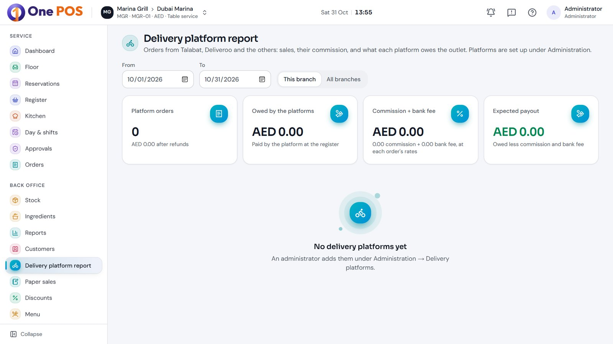

## Paper sales (outages)

Before an outage, print numbered blank pads (**Print pads**, four per A4). Afterwards, key in each slip under **Enter a paper slip**: slip number, date and time, items, discount and payment, then **Enter slip**. Each becomes a paid order with a tax invoice number; a slip number can be entered only once and nothing goes to the kitchen.

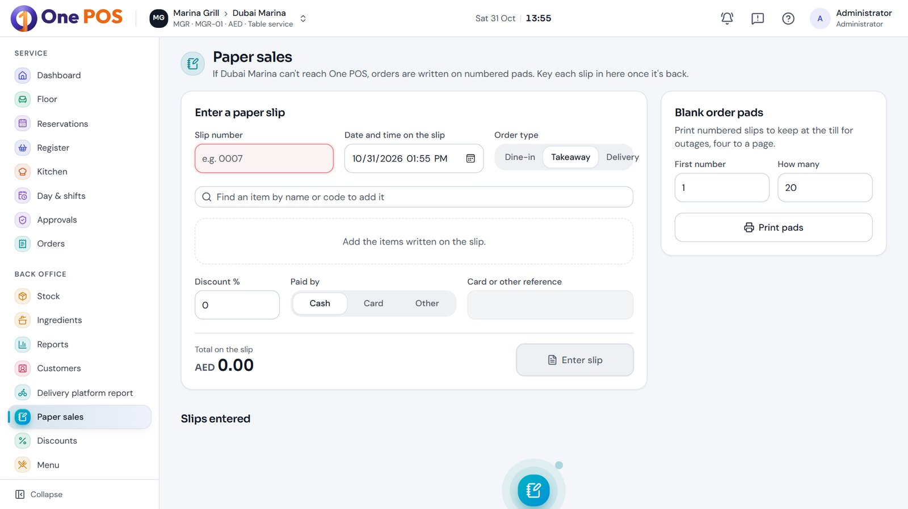

## Tables & floors

In **Tables & floors**, add floors and **Round**, **Square** or **Long** tables, drag them into place and set their seats. A table with an open order cannot be removed.

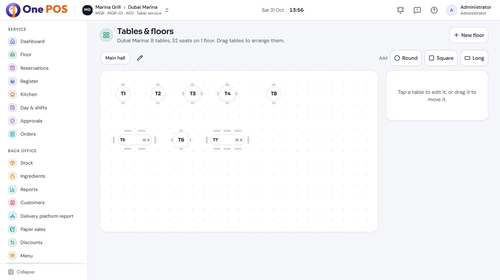

# Admin

Administrators set up companies, branches, people and the link to FACTS. Most settings are switches per branch, off until you need them.

## Set up a new branch: checklist

1. **Companies & branches** → **Add branch**: name, address, phone, Arabic name and address.
2. Set **Table service** or **Quick service**, the **Kitchen** switch, and **Day open and close** (Manual, Automatic or Cashier-run) with the usual float and the accepted variance.
3. FACTS companies: fill **FACTS stock location** (location code, wastage location, item types, price type) and the approvers for wastage, marketing and stock requests.
4. **Users**: give staff this branch under **Branches** and a **Till PIN**.
5. **Devices** on each till PC: install the Device Service, choose the receipt printer, **Test print**.
6. On each till, user menu → **Use this device as a till for (branch)**.
7. **Menu** → **Switch on what sold here**, and check **No price** is empty.
8. **FACTS posting** → **Branches**: set the **Posts from** date (the day the old POS stops posting there).

## Companies & branches

Company settings (administrators): name, legal names in English and Arabic, TRN, currency, VAT rate, whether menu prices include VAT, the ERP (**Standalone**, **AWS One** or **FACTS**), and the **Gift vouchers** and **Loyalty points** switches. **Request stores** lists the FACTS stores branches may request stock from.

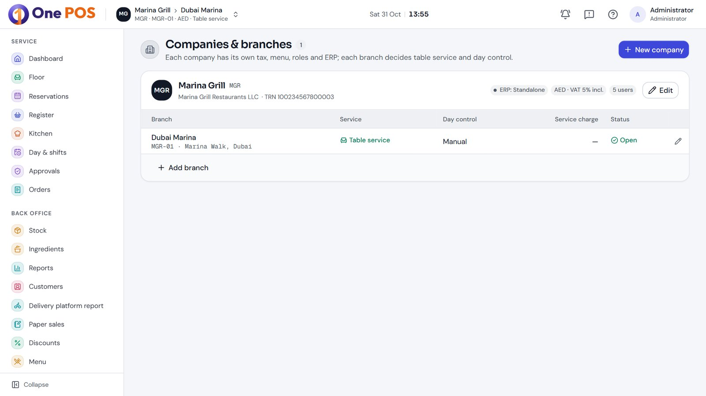

Key branch settings:

| Setting | Choices |
| --- | --- |
| Receipts | English and Arabic, or English only |
| When stock runs short | Allow (sell anyway), Warn, Block |
| Order-ready screen | Off, Automatic, Cashier taps ready |
| Table service | Guests asked when seating, service charge on dine-in (%) |
| Kitchen | Off for a café or counter: no Send, no tickets, no kitchen display |
| Day open and close | Manual, Automatic (opens at, closes at, delays for waiting customers), Cashier-run; orders still open at day close |
| Returns | On or off; **Returns accepted for (days)**, 0 = the same day |
| Discount approval email | Where approval codes are emailed |
| Wastage approval, Marketing, Stock requests | Approver, email and FACTS username (FACTS companies) |

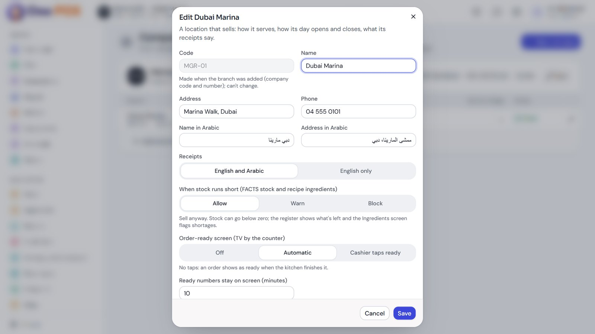

Table service cannot be switched off while dine-in orders are open.

## FACTS connection

On a FACTS company card, open **FACTS connection**, paste the **Connection string**, tap **Test**, then **Save**. Use a read-only login: One POS warns if it can write. The saved string is encrypted and never shown again; **Replace with a new connection string** or **Remove** it later.

## Users

1. **Users** → **New user**: name and **Username** (cannot change later).
2. Pick the **Role** and the **Branches** they work at.
3. **Set PIN** for till staff (4–6 digits, unique in the company; easy PINs such as 1111 or 1234 are refused). Give a **Back-office password** only to back-office users.
4. Optionally override the role's limits under **Limits for this user**.

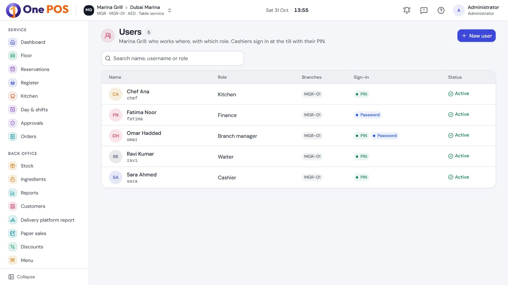

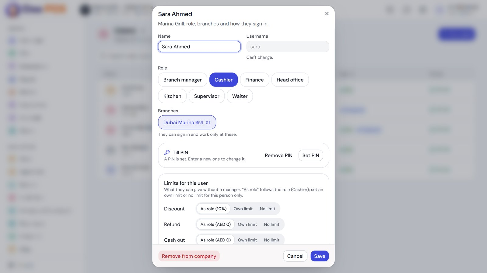

Switch **Active** off to stop someone signing in anywhere; **Remove from company** keeps their history. Only an administrator can make someone an **Administrator** (every right, every company, no limits).

## Roles

**Roles** → **New role**, then tap the rights to give or take and set the three limits: largest discount (%), refund and cash-out without approval. Changes apply at each user's next action. The starting roles are Cashier, Waiter, Kitchen, Supervisor, Branch manager, Head office and Finance.

## FACTS posting

| Part | What it does |
| --- | --- |
| Post to FACTS | The master switch (off by default). Off: bills wait in the queue. |
| Company options | Batches (finance or FIFO with each bill), wastage, BOM items (repacking), refunds (not posted, PSR51 or SR50) |
| Branches | Queue counts per branch and the **Posts from** date. The old POS and One POS must never post the same day for a branch. |
| Dry run | A day's bills as they would go, with any problems; nothing is sent. |
| Posting log | **All / Failed / Waiting / Posted**; **Push now**, **Re-push failed**, per row **Re-push** or **Leave out** (finance then enters it by hand). |

## Delivery platforms

**Add platform** (or **Add quickly:** Talabat, Deliveroo, Careem, Noon Food, Keeta, Smiles) with its **Commission (%)** and **Bank fee (%)**, and link it to its FACTS customer for platform prices. **Track platform payouts in One POS** adds payouts to the platform report.

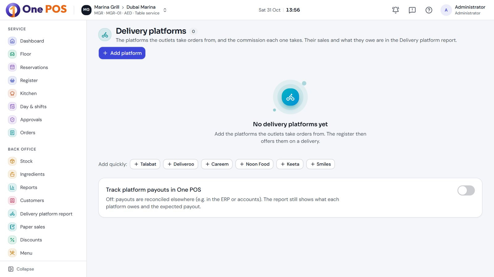

## Devices

Settings on **Devices** belong to the PC you are on.

1. If it says **The Device Service isn't running on this PC**, tap **Download the installer**, run it, then **Check again**.
2. Choose the **Receipt printer**, the **Paper width** (80 or 58 mm) and whether the drawer opens with cash. **Save**, then **Test print** and **Open drawer**.
3. Under **Kitchen & bar**, give each station a ticket printer or **No printer (display only)**.

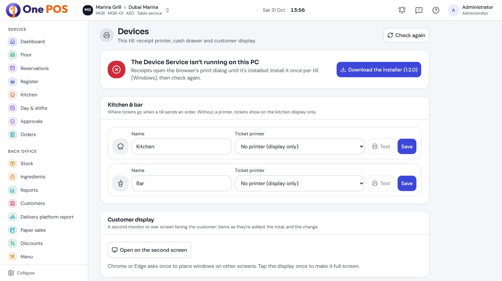

**This branch's PCs** shows every PC: online or last seen, printer state (Ready, Paper out, Offline) and the last error. The service updates itself; **Update now** forces it.

## Receipt & display

The **Receipt** tab sets the language, the name printed, which header lines show (logo, Arabic names, address, phone, TRN…), table, customer, till and cashier, the QR code to the digital receipt, extra header lines and footer, with a live preview. The **Customer display** tab holds the pictures shown between orders, for every branch or one.

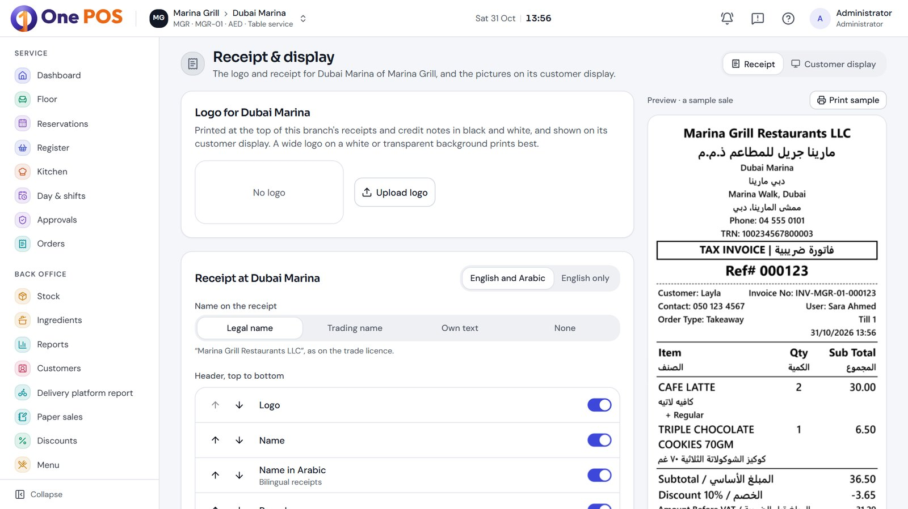

## Daily summary & alerts

When a branch closes its day, a summary goes to the newspaper icon (and by email once an email server is set). Set the alert limits (voids, refunds, no-sales, discount %, cash variance, shifts closed without a count), the email list, approval reminders and the **Email server (SMTP)**.

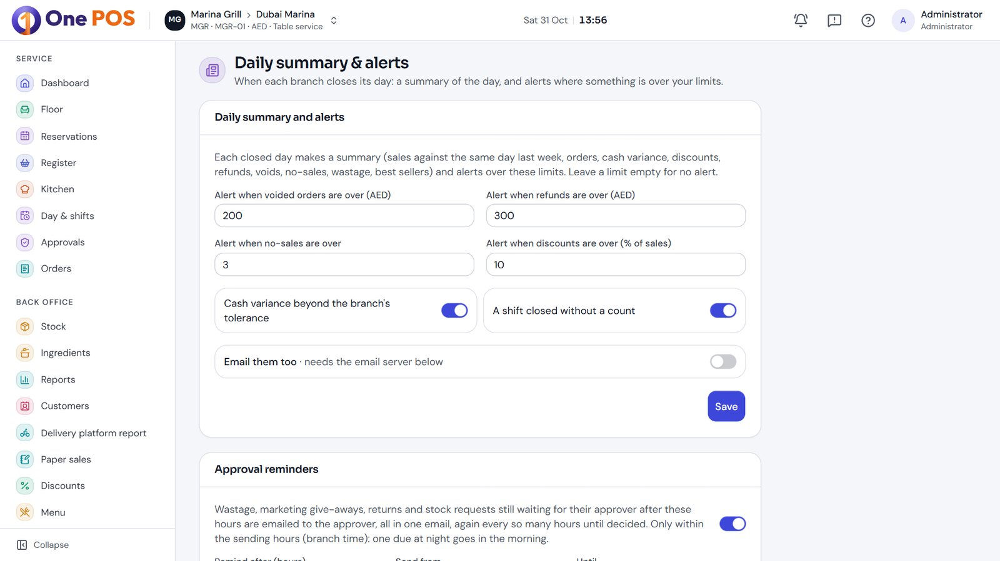

## Audit log and problem reports

**Audit log** lists every sign-in and change, newest first; tap a row for details. **Problem reports** is the inbox for **Report a problem**: set the **Status**, **Priority**, **Assigned to** and a **Resolution** the reporter sees.

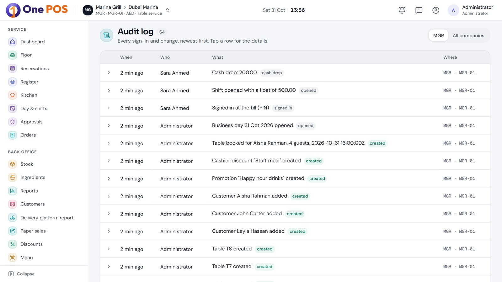

# Troubleshooting

Most messages say what to do. The ones staff ask about most:

| Message | What to do |
| --- | --- |
| Reconnecting to One POS… | Wait before taking payments; nothing sent is lost or doubled. If it stays, check the network. |
| Open your shift first: count the float in the drawer | Open your shift on the Dashboard. |
| Pick the register you're at first | Choose the register on the Dashboard, then open your shift. |
| The business day isn't open yet | A manager opens it under Day & shifts. |
| Today's business day was already closed | A manager with the reopen right reopens it under Day & shifts. |
| Close the open shift(s) first: (name) on (till) | Close those shifts before closing the day. |
| You already have a shift open on another register | Close that shift first. |
| (Item) has no price yet / has no price in FACTS for this outlet yet | The price must be set in FACTS (the branch's price type). Sell something else meanwhile. |
| (Item) is sold out today / Not enough stock in FACTS / Not enough (ingredient) | The branch blocks selling beyond stock. Receive or check the stock, or sell something else. |
| Order #N is open on (till) | Tap **Take over** to work on it here. |
| This went to the kitchen. Ask a supervisor to void it. | A supervisor voids sent items. |
| Your role allows discounts up to X % | Use **Manager approval**: PIN, request or emailed code. |
| That code doesn't work | The code is wrong, used, for another order or a smaller discount, or older than 24 hours. Ask for a new one. |
| Choose the card type. | Pick VISA, MASTER etc. before paying by card. |
| Returns are switched off for this branch | An administrator switches Returns on under Companies & branches. |
| Only a manager returns a bill from an earlier day | Ask a manager, or use Manager approval. |
| No receipt printer chosen on this till | Choose one under Devices → Receipt printer. |
| The One POS Device Service isn't running on this till | Restart the PC or install it from Devices. Receipts meanwhile open in the browser's print window. |
| Too many wrong PINs. The PIN pad is locked for a few minutes. | Wait a few minutes, or ask a manager to reset the PIN. |
| Wrong PIN, or this user doesn't work at this branch | Check the PIN and the user's branches under Users. |
| This user is switched off | Ask an administrator. |
| This till's register was removed or switched off | A manager sets the till up again (user menu). |
| (Item) isn't a FACTS item (no item code) (posting log) | Fix the item in FACTS, then **Re-push**, or **Leave out** for finance. |
| Some of these were decided meanwhile | Someone else answered first: refresh. |

Still stuck? Use **Report a problem** in the header: describe what happened and keep the screenshot ticked.

# Glossary

| Term | Meaning |
| --- | --- |
| Branch | One outlet. Everything you see follows the branch in the header. |
| Register / till | A cash point of a branch; a till is the PC set up as that register. |
| Shift | One cashier's time on a register, from float count to closing count. |
| Business day | The trading day of a branch, opened and closed once; it may run past midnight. |
| Float | The cash in the drawer when a shift opens. |
| Blind count | Counting the drawer at close without seeing the expected amount. |
| Variance | Counted cash minus expected cash. |
| X report / Z report | A report so far (X) or the final report when a shift or day closes (Z). |
| Safe drop | Cash taken from the drawer to the safe during a shift. |
| No sale | Opening the drawer without a sale. |
| Void | Cancelling an order or item before payment. |
| Return / credit note | Taking back a paid bill; the credit note is the tax document for it. |
| Park | Leaving an order open to start another. |
| Combo | A set menu built from menu items. |
| BOM | Bill of materials: the raw materials one item is made from. |
| Approver | The person named per branch to approve wastage, marketing, returns or stock requests. |
| FACTS | The company's ERP; One POS takes items, prices and stock from it and posts sales back. |
| POS51 | FACTS point-of-sale invoice: every paid bill. |
| PSR51 | FACTS point-of-sale return: every returned bill. |
| STV50 | FACTS stock transfer: deliveries in, wastage out, returns to the store. |
| STR50 | FACTS stock transfer request: a branch's request to a store. |
| RPO50 | FACTS repacking voucher: raw materials into made items (BOM). |
| MCV50 | FACTS material consumption: marketing give-aways. |
| Price type (PTM) | The FACTS price list a branch sells at. |
